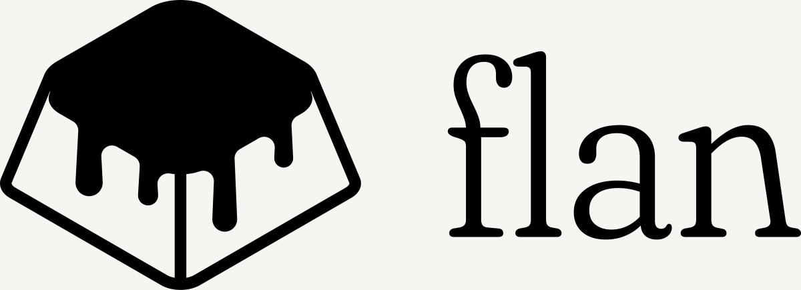
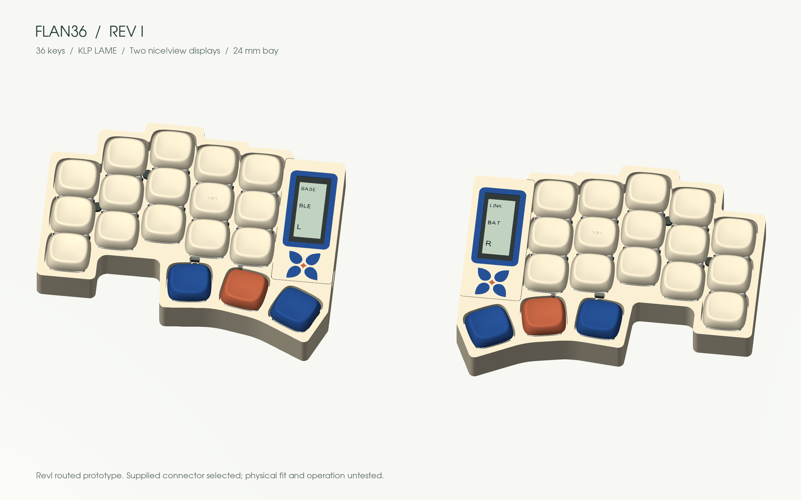
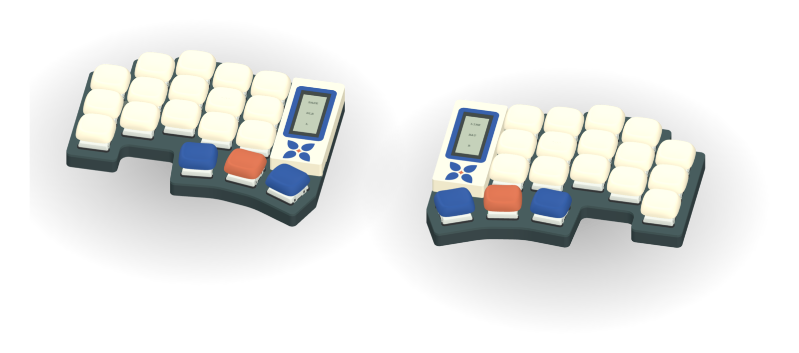
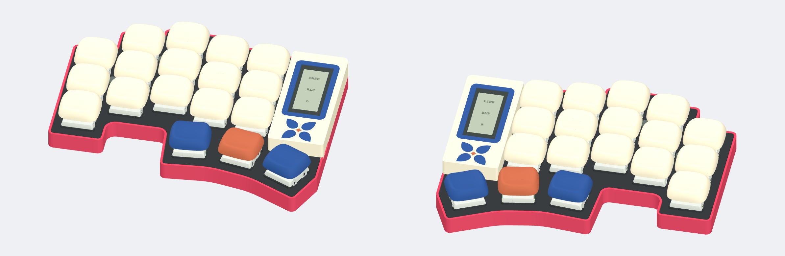
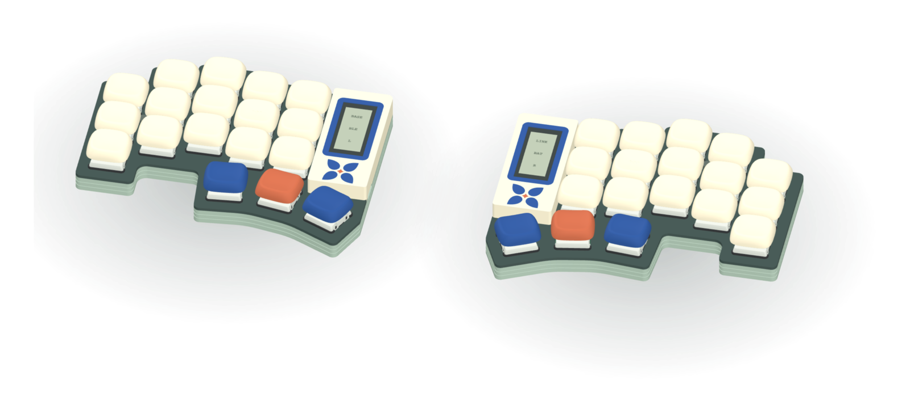
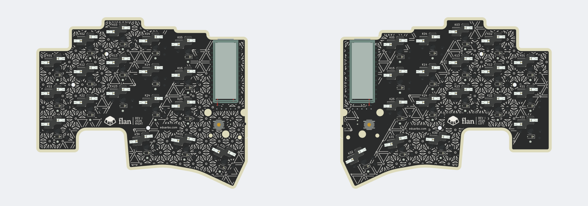

# Flan36

**36 keys. Original design. Your keycaps, your frames.**

**[Explore and customize in 3D →](https://eduarbo.github.io/flan/)** · **[Parts and buying links →](docs/parts.md)** · **[Order PCBs →](docs/electronics.md#order-the-two-pcbs)** · **[Edit in FreeCAD →](docs/freecad.md)**

*RevI with the Level case: key-aligned local curves, four interchangeable cases, optional exposed display stack, magnetic frames and a floor-mounted cell in either battery size. Physical fit untested.*

**[Silkscreen editions](docs/electronics.md#editions)** — Asanoha, Kikkō, Sayagata, Seigaiha, Meandro and Vías: six all-over back patterns around the Flan signature, one Gerber package each. Preview them with JLCPCB's seven solder-mask colours in the viewer's **Design → PCB** tab, which links the matching ZIPs.

**[The Flan family](docs/variants.md)** — Flan42 adds the outer pinky column, Flan46 a number row and Flan54 both. They keep every Flan36 key, the thumbs and the bay; layouts, matrices and case outlines are generated and checked, and PCBs and cases come next.

**[Themes and print kits](docs/themes-printing.md)** — Twenty-eight coordinated themes, personal keycap palettes, linked rim/frame colors and selected STL/3MF parts.

**[Lower, level stack](docs/level-stack.md)** — The frame and removable switch-covering shell reach 14.50 mm; the glass sits 0.20 mm below them. The display uses its supplied 5 mm socket + 2 mm header; physical assembly remains to be tested.

**[Case variants](docs/cases.md)** — Level, Solid, Color rim and Terrace; actual meshes in the explorer.

**[Viewer controls](docs/viewer.md)** — A draggable mobile drawer, direct component visibility controls and a magnet locator. [Port refinement and verification](docs/reviews/interaction-refinement.md) documents the restored frame wall around USB and power access, including the retained cable and switch clearances.

Flan36 is a low-profile wireless split keyboard in development by [Eduardo Ruiz](https://github.com/eduarbo). Its original CAD is designed by Eduardo, with five columns and three thumb keys per half.

- **KLP Lamé choices:** all 38 Choc-stem variants catalogued; 28 qualify in at least one position. The viewer checks complete combinations and exports a configuration for FreeCAD.
- **Magnetic frames:** six Ø2 × 3 mm base magnets pair with six Ø2 × 4 mm frame magnets from existing stock; [polarity and assembly](docs/build.md#magnetic-frame-and-service). Talavera (default), Game Boy, SNES, 2000s Phone, iPod and Hanafuda. Up to four solid colors in flush inlays, with matching rim and key palettes.
- **Keycap colors:** paint all keys, rows, columns or individual keys; save and share your own palettes.
- **Free tools:** KiCad for electronics, FreeCAD for the case, StepUp for exchange. Editable source, STEP/STL, offline viewer and GLB included.
- **Intended hardware:** Choc v1 hot-swap, two nice!nano controllers and two nice!view displays. One display remains the fallback.

**Status: routed prototype; physical qualification pending.** Both PCBs pass DRC, schematic parity and ERC with no unconnected items. Three [ZMK firmware builds](docs/firmware.md) cover two displays or a left-only display. [Prototype fabrication files and verification](docs/electronics.md) are included. Exact connectors, printed retention, BLE, charging and measured power still need hardware tests.

| Solid | Color rim | Terrace |
|---|---|---|
|  |  |  |

**[Keycaps and frames](docs/customize.md) · [Design](docs/design.md) · [Build](docs/build.md) · [CAD files](docs/cad.md) · [Progress](docs/progress.md)**

[Piantor by beekeeb](https://github.com/beekeeb/piantor) inspired the number of keys. The viewer uses [KLP Lamé by braindefender](https://github.com/braindefender/KLP-Lame-Keycaps). [Credits and licenses](ATTRIBUTION.md). [Contributing](CONTRIBUTING.md).
