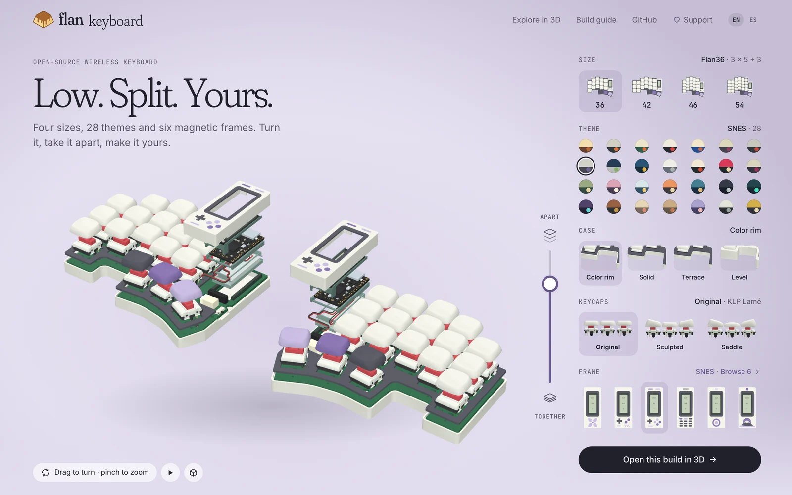
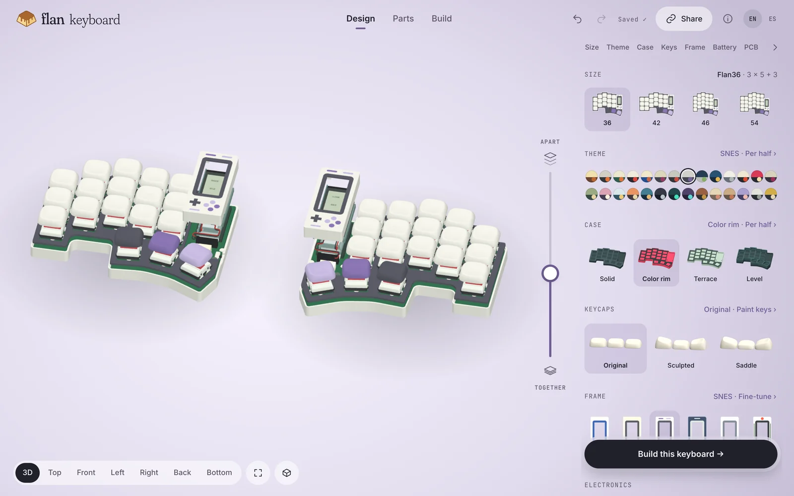
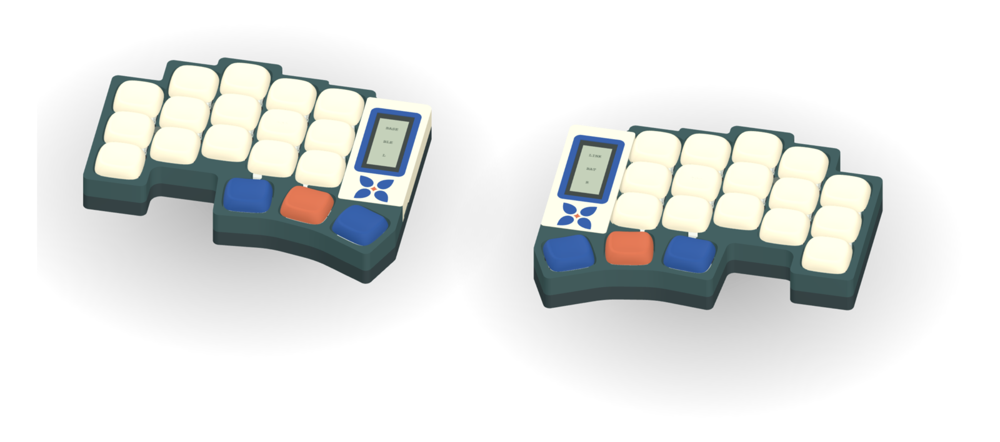

# Flan

**Low. Split. Yours.** An open-source wireless split keyboard in four sizes, with interchangeable cases, magnetic display frames, 28 themes and your own keycap colors.

**[flankbd.com →](https://flankbd.com/)** · **[Explore and customize in 3D →](https://flankbd.com/explore/)** · **[Parts and buying links →](docs/parts.md)** · **[Order PCBs →](docs/electronics.md#order-the-two-pcbs)** · **[Build guide →](docs/build.md)** · **[Edit in FreeCAD →](docs/freecad.md)**

| [Home page](https://flankbd.com/) | [3D explorer](https://flankbd.com/explore/) |
|---|---|
|  |  |

**[Four sizes](docs/variants.md)** — Flan36 (3 × 5 + 3 per half) is the reference. Flan42 adds the outer pinky column, Flan46 a number row and Flan54 both. Every size keeps the thumbs and the bay, and has routed PCBs, six silkscreen editions, the four case styles and ZMK firmware. Pick one in the explorer under **Design → Size**.

**[Silkscreen editions](docs/electronics.md#editions)** — Asanoha, Kikkō, Sayagata, Seigaiha, Meandro and Vías: six all-over back patterns around the Flan signature, one Gerber package each. Preview them with JLCPCB's seven solder-mask colors under **Design → PCB**, which links the matching ZIPs.

**[Themes and print kits](docs/themes-printing.md)** — Twenty-eight coordinated themes, personal keycap palettes, linked rim/frame colors and selected STL/3MF parts.

**[Lower, level stack](docs/level-stack.md)** — The frame and removable switch-covering shell reach 14.50 mm; the glass sits 0.20 mm below them. The display uses its supplied 5 mm socket + 2 mm header; physical assembly remains to be tested.

**[Case styles](docs/cases.md)** — Level, Solid, Color rim and Terrace; actual meshes in the explorer.

**[Using the explorer](docs/viewer.md)** — Design, Parts and Build beside the model (Build lists every part, PCB, print file and firmware for your design), a phone sheet with the home page's tabs, share links that open your exact keyboard, English and Spanish. [Port refinement and verification](docs/reviews/interaction-refinement.md) documents the restored frame wall around USB and power access, including the retained cable and switch clearances.

Flan is a low-profile wireless split keyboard in development by [Eduardo Ruiz](https://github.com/eduarbo). Its original CAD is designed by Eduardo; Flan36 has five columns and three thumb keys per half.

- **KLP Lamé choices:** all 38 Choc-stem variants catalogued; 28 qualify in at least one position. The explorer checks complete combinations and exports a configuration for FreeCAD.
- **Magnetic frames:** six Ø2 × 3 mm base magnets pair with six Ø2 × 4 mm frame magnets from existing stock; [polarity and assembly](docs/build.md#magnetic-frame-and-service). Talavera (default), Game Boy, SNES, 2000s Phone, iPod and Hanafuda. Up to four solid colors in flush inlays, with matching rim and key palettes.
- **Keycap colors:** paint all keys, rows, columns or individual keys; save and share your own palettes.
- **Free tools:** KiCad for electronics, FreeCAD for the case, StepUp for exchange. Editable source, STEP/STL, offline explorer and GLB included.
- **Intended hardware:** Choc v1 hot-swap, two nice!nano controllers and two nice!view displays. One display remains the fallback.

**Status: routed prototype; physical qualification pending.** Both Flan36 PCBs pass DRC, schematic parity and ERC with no unconnected items. Three [ZMK firmware builds](docs/firmware.md) cover two displays or a left-only display. [Prototype fabrication files and verification](docs/electronics.md) are included. Exact connectors, printed retention, BLE, charging and measured power still need hardware tests.

| Level | Solid | Color rim | Terrace |
|---|---|---|---|
|  |  |  |  |

**[Keycaps and frames](docs/customize.md) · [Design](docs/design.md) · [Build](docs/build.md) · [CAD files](docs/cad.md) · [Explorer](docs/viewer.md) · [Progress](docs/progress.md)**

Flan36 is inspired by [Piantor by beekeeb](https://github.com/beekeeb/piantor) and keeps its 36 key positions and angles; the wireless PCBs, case outline, cases, frames and firmware are original. The viewer uses [KLP Lamé by braindefender](https://github.com/braindefender/KLP-Lame-Keycaps). [Credits and licenses](ATTRIBUTION.md). [Contributing](CONTRIBUTING.md).

## Support Flan

Flan is free to build. If it is useful to you, [support it on Ko-fi](https://ko-fi.com/eduarbo): it funds prototypes, test boards and new sizes.

## License, trademark and official kits

Build, modify, share and sell Flan under [GPL-3.0-or-later](LICENSE), with the third-party terms listed in [ATTRIBUTION.md](ATTRIBUTION.md). The license covers the files, not the **Flan** name and logos: products sold under the Flan name or carrying its marks need permission. Official kits come only from Eduardo or licensed sellers. [Trademark policy and official kits →](TRADEMARKS.md)
