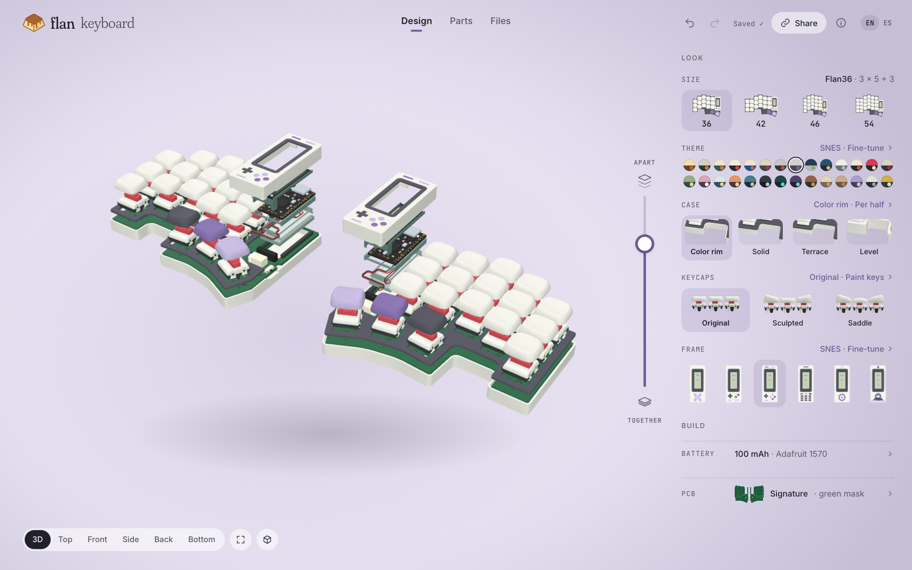
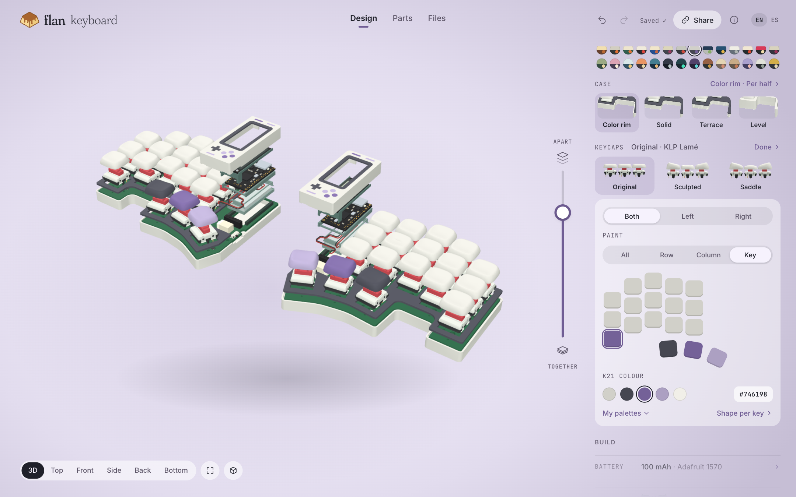
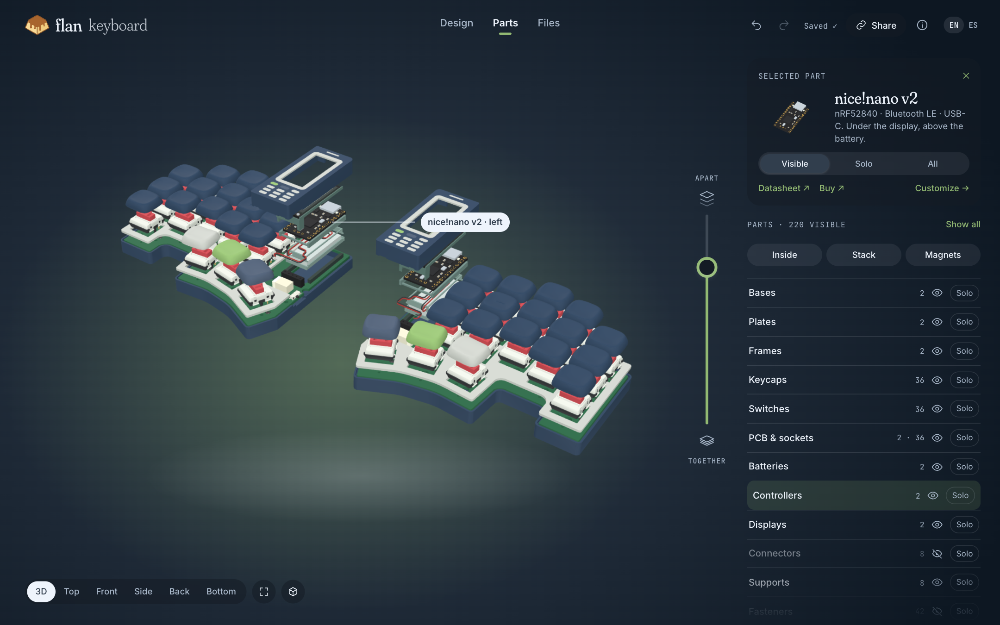
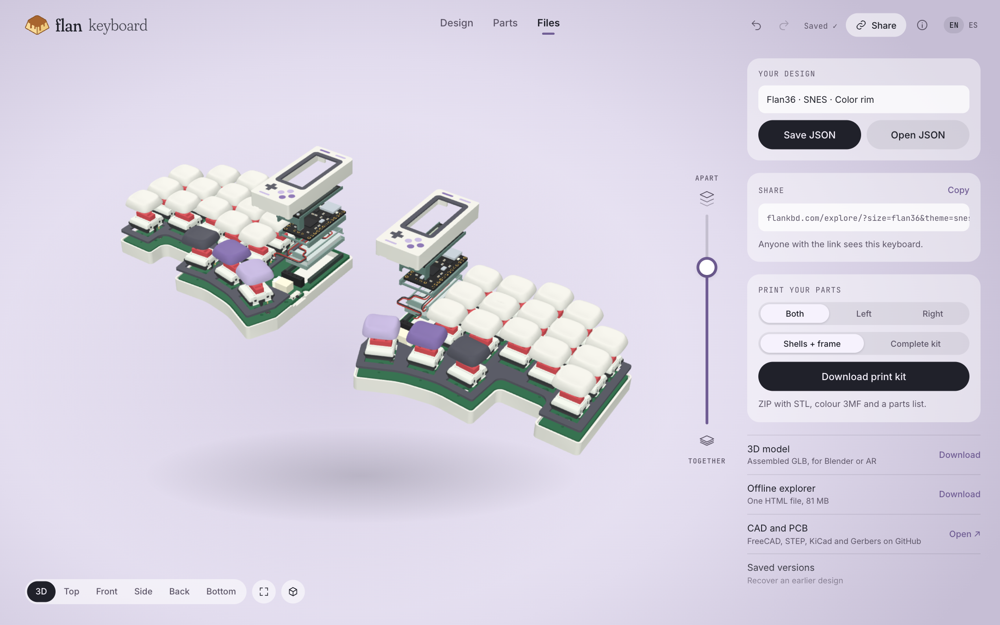
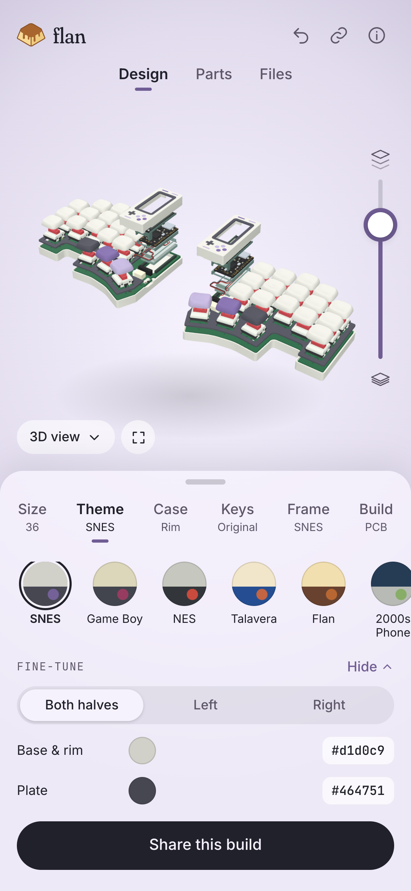

# Explorer · R1

The 3D explorer redrawn in the home page's language. The page follows the theme, the panel on the right has no outline, layers move on a vertical slider, and every option shows a real thumbnail. The usual options are in view. Everything advanced opens in place behind one quiet link per section, so nothing is lost and nothing adds noise. The images are mockups built from the real model and live thumbnails, not screenshots of a built page.

## A · Design

- **Top bar:** the lockup back home, three modes (**Design · Parts · Files**), undo and redo, the save state, **Share** (copies a link that opens this exact keyboard), About (ⓘ) and EN/ES.
- **Look:** Size, Theme, Case, Keycaps and Frame, as on the home page.
- **Build:** Battery and PCB as single rows that open when needed.
- **Fine-tune links:** each section has one in the accent colour, for per-half choices, colours, key painting and so on.
- **Model:** a single chip holds the camera views, Fit and Reset.

## B · A section opened: Keycaps → Paint keys

The section expands in place:

- **Halves:** Both, Left or Right.
- **Paint:** All, Row, Column or Key.
- **Key map:** the real left-half layout, with its column stagger and angled thumbs.
- **Colour:** the theme's colours and HEX.
- **More:** My palettes and the shape per key.

**Done** closes it.

## C · Parts (in the 2000s Phone theme)

The selected part leads the panel:

- **Card:** its own render and what it is.
- **Visibility:** Visible, Solo or All.
- **Links:** datasheet, purchase and **Customize →**.
- **On the model:** a label points at the part.
- **Below:** the quick views (Inside, Stack, Magnets) and every group with its eye and **Solo**.

## D · Files

- **Your design:** save or open the JSON.
- **Share:** the link to this exact keyboard.
- **Print kit:** halves and what to include.
- **Downloads:** GLB, the offline explorer and the CAD and PCB sources.
- **Saved versions:** in the last row.

## E · Phone

The model stays on top with the slider at the thumb, and the camera views fold into one chip. A sheet holds the home page's tabs plus **Build** (battery, PCB). Fine-tune opens inside the sheet.

## Where today's controls go

| Today | R1 |
|---|---|
| Design → Case: size, style, both/left/right, colours, match frame | Size and Case sections; per half and colours under **Per half ›** |
| Design → Frame: six designs, colours, restore, install left/right | Frame section; colours, restore and installed frames under **Fine-tune ›** |
| Design → Keys: shape, paint all/row/column/key, palettes | Keycaps section; painting, palettes and shape per key under **Paint keys ›** |
| Design → Colors: 28 themes, both/left/right | Theme section; per half and custom colours under **Fine-tune ›** |
| Design → Battery, PCB (editions, masks, underside, Gerbers) | Build rows; each opens in place |
| Parts: layers, eye, Solo, Inside/Stack/Magnets, selection detail | Parts mode, selected part first |
| Files: JSON, print kit, GLB, offline, recovery | Files mode, plus **Share** |
| About, credits and licenses | ⓘ in the top bar |
| Camera views, fit, separate layers, undo/redo, reset | One camera chip, the vertical slider, the top bar |

Regenerate: `node design/proposals/explorer-r1/src/capture.cjs` (real thumbnails and model renders from the built home and explorer), then `node design/proposals/explorer-r1/src/render.cjs`.
