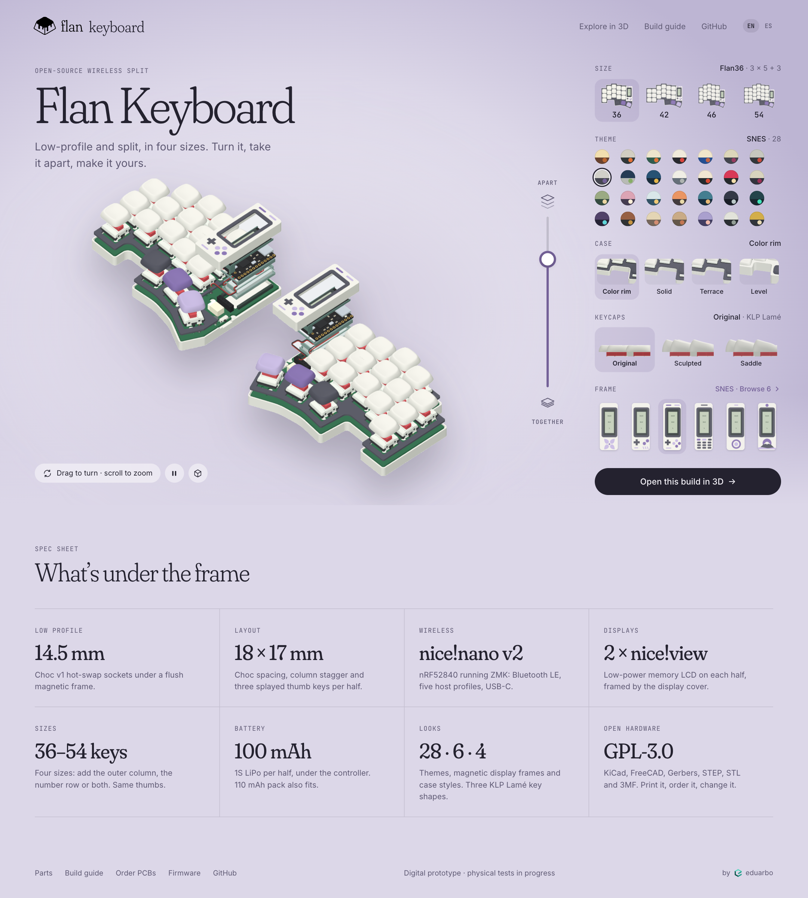
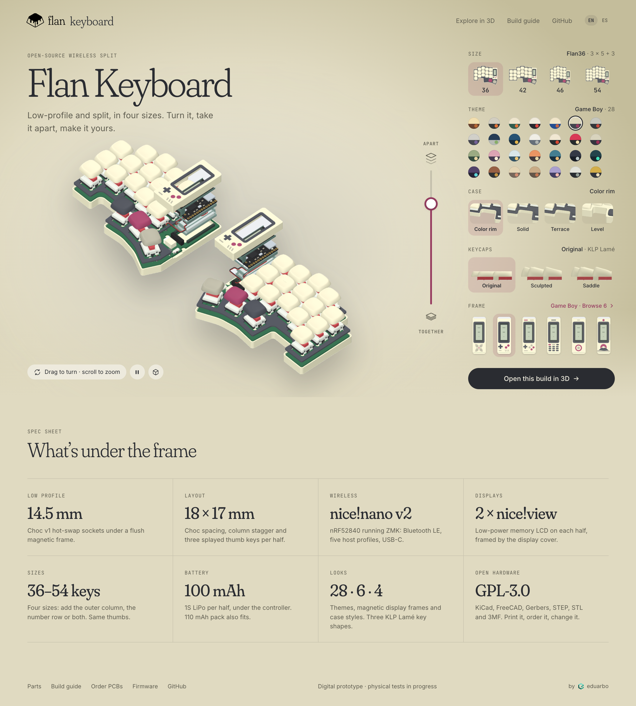
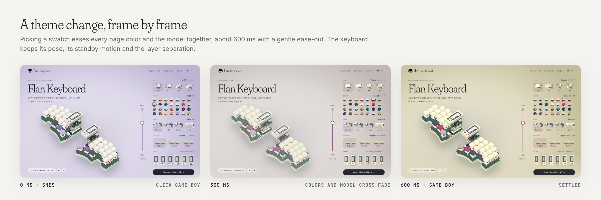
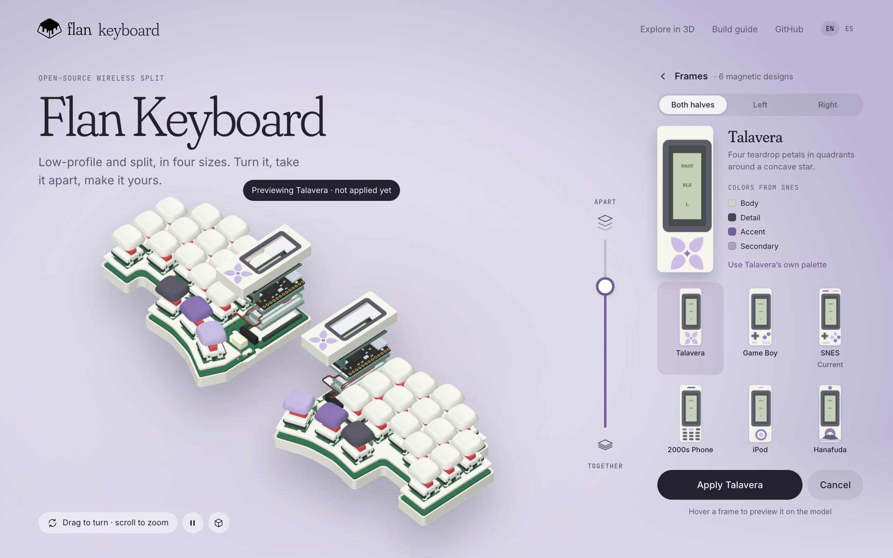
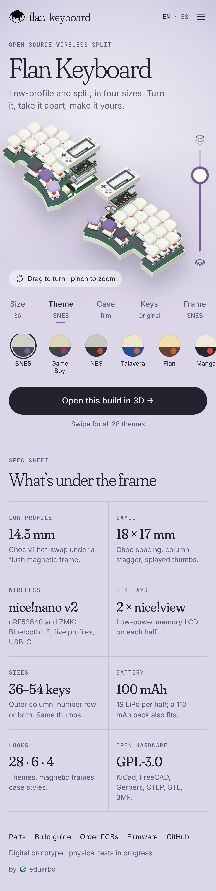

# Home page · R4

Immersive como base: el fondo, el texto, los acentos y las vistas previas siguen al tema elegido. Los controles van en un rail a la derecha, sin contorno ni panel. El slider de capas es vertical. Por defecto: Flan36, SNES, Color rim y Original. Todas las imágenes del modelo y de las opciones son renders del visor real; no hay ilustraciones dibujadas a mano.

## A · SNES, página completa



- **Modelo 3D en vivo.** Al cargar, las capas se separan solas hasta 75 % en ~1.2 s y luego queda un balanceo lento de standby. Arrastrar gira el modelo y pausa el standby; ⏸ lo detiene y el botón del cubo restablece la vista.
- **Capas en vertical.** Arriba se separan las capas, abajo vuelven a su sitio.
- **Rail sin contorno.** Cada opción lleva su vista previa real:
  - Tamaño: la mitad izquierda vista desde arriba; se ven la columna exterior y la fila de números.
  - Tema: los 28, cada uno con su base, placa y acento.
  - Caja: el pie del meñique, donde los cuatro estilos difieren.
  - Keycaps: el perfil lateral sobre el switch.
  - Marco: los seis diseños magnéticos.
- **Spec sheet** para entusiastas, con los datos verificados abajo.
- **«by eduarbo»** pequeño, al final del footer.

## B · El mismo home en Game Boy



## Transición de tema



Los colores de la página y el modelo hacen cross-fade juntos en unos 600 ms. El modelo conserva su pose, el standby y la separación.

## C · Explorar marcos antes de elegir



«Browse 6» cambia el rail por los seis marcos, con una vista grande y su descripción de forma. Pasar el cursor previsualiza el marco en el modelo; nada se aplica hasta pulsar **Apply**. Mantiene el selector Both halves · Left · Right del visor.

**Decisión propuesta: el tema controla los colores y el marco solo la forma.**
- Las previsualizaciones salen en los colores del tema actual, así que muestran exactamente lo que vas a obtener.
- «Use Talavera’s own palette» aplica la paleta original del diseño, como «Restore design colors» en el visor.
- Al aplicar la paleta propia de un marco, el visor también recolorea la caja y los thumbs vinculados.

## E · Teléfono



En el teléfono, las pestañas Size · Theme · Case · Keys · Frame muestran una fila deslizable de opciones. El slider de capas queda a la derecha del modelo, al alcance del pulgar.

## Datos técnicos y su fuente

| Dato | Fuente |
|---|---|
| 14.5 mm: plano del marco y de la caja Level | [frames-extra.md](../../../docs/frames-extra.md) |
| 18 × 17 mm; pulgares a 5°, −10° y −25° | `keycaps/catalog.json` → `layout` |
| nice!nano v2 (nRF52840) con ZMK, 5 perfiles Bluetooth y USB-C | [parts.md](../../../docs/parts.md), [firmware.md](../../../docs/firmware.md) |
| 2 × nice!view, memory LCD de bajo consumo | [parts.md](../../../docs/parts.md) |
| 100 mAh (Adafruit 1570) o 110 mAh (301230) por mitad | [parts.md](../../../docs/parts.md) |
| 6 marcos instalados: Talavera, Game Boy, SNES, 2000s Phone, iPod y Hanafuda | catálogo del visor (`tools/viewer_frame_selection.py`) |
| 28 temas, 4 cajas y 3 formas KLP Lamé | `design/themes.json`, `keycaps/catalog.json` |

## Regenerar

Con `FLAN36_PLAYWRIGHT_MODULE` y `FLAN36_BROWSER` definidos (como en `viewer/check.cjs`):

```sh
node design/proposals/home-r4/src/capture.cjs          # poses de standby
node design/proposals/home-r4/src/capture-options.cjs  # tamaños, cajas y keycaps por tema
node design/proposals/home-r4/src/capture-preview.cjs  # marcos en colores del tema
sh design/proposals/home-r4/src/process.sh             # recortes transparentes en assets/
node design/proposals/home-r4/src/render.cjs           # mockups PNG
```

Los renders crudos van a `build/r4/`, que está ignorado.
