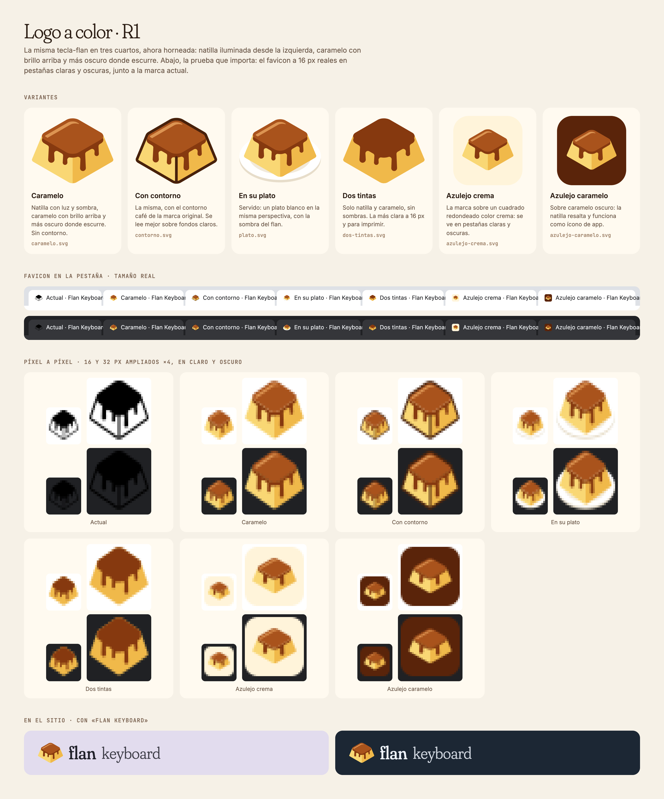

# Logo a color · R1

La misma tecla-flan en tres cuartos, ahora horneada. La natilla está iluminada desde la izquierda; el caramelo brilla arriba y oscurece donde escurre. La geometría es la de la marca actual (`tools/branding/flankey.iso_regions`): solo cambian los rellenos.



| Variante | Para qué |
|---|---|
| [Caramelo](caramelo.svg) | La marca a color, sin contorno. Se lee en fondos claros y oscuros. |
| [Con contorno](contorno.svg) | La misma con el contorno café de la marca actual. Mejor sobre fondos claros. |
| [En su plato](plato.svg) | Servida, con plato y sombra. Más ilustración que marca: buena para portadas, débil a 16 px. |
| [Dos tintas](dos-tintas.svg) | Solo natilla y caramelo, sin sombras. Útil para imprimir y bordar. |
| [Azulejo crema](azulejo-crema.svg) | La marca sobre un cuadrado redondeado crema. El favicon más visible en pestañas oscuras. |
| [Azulejo caramelo](azulejo-caramelo.svg) | Sobre caramelo oscuro. Ícono de app (iOS, Android, PWA). |

La marca actual, negra con contorno fino, se pierde a 16 px y casi desaparece en pestañas oscuras.

**Mi recomendación:**
- **Caramelo** como marca del sitio y favicon SVG, porque se adapta a cualquier fondo.
- **Azulejo caramelo** como ícono de app y `apple-touch-icon`.
- La versión de una tinta se queda para la serigrafía del PCB.

Paleta: natilla `#F9D774` / `#F0B94A`, caramelo `#A9531C` / `#86390F` / `#5A240A`, brillo `#DC9452`, contorno `#48210B`, crema `#FFF4DA`.

Regenerar:

```sh
python3 tools/branding/color_marks.py                      # SVG y PNG a 16, 32, 64 y 256 px (shapely, rsvg-convert)
node design/proposals/logo-color-r1/src/render.cjs        # sheet.png (FLAN36_PLAYWRIGHT_MODULE, FLAN36_BROWSER)
```
