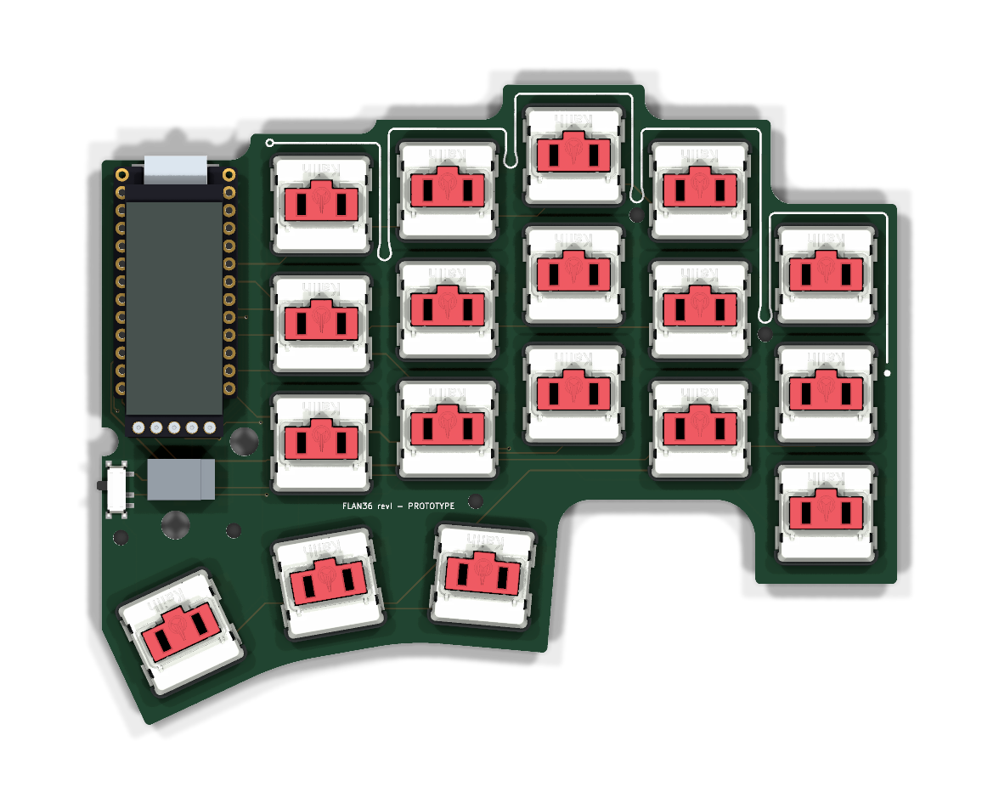
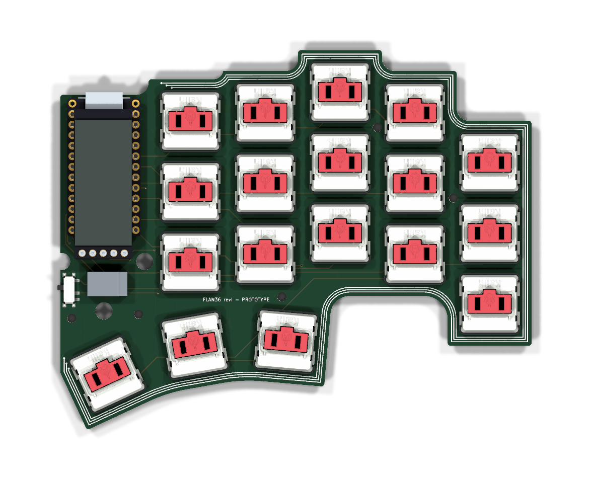
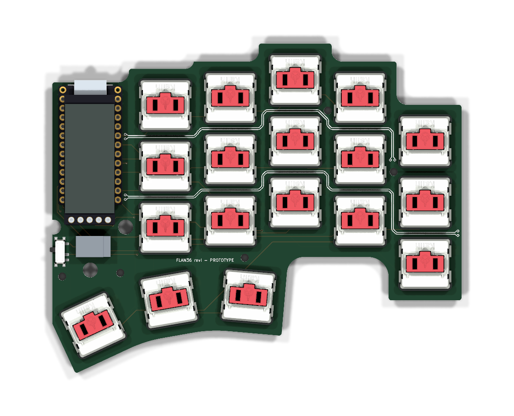

# Silkscreen R1 — circuit-language legends

**Proposal, not installed.** Three front-side treatments for both revI boards plus one shared back plate. The routed PCBs and fabrication ZIPs are unchanged; one concept must be chosen before integration.

Each design speaks the board's own language: constant-width traces, 45° routing, vias, a differential pair. All art sits on F.SilkS/B.SilkS only, in the free channels between switches, so it stays visible with switches fitted. The case covers the PCB once assembled; this is for the bare board and the builder.

| Concept | Idea | Front (right half, switches fitted) |
|---|---|---|
| **A — Caramelo** (recommended) | One 0.30 mm trace hugs the top edge and drips between the columns, like the caramel in the logo — and like a length-tuning meander. Two drips stop just above mounting holes H1/H2; the right edge ends in a falling drop. |  |
| **B — Contorno** | A three-conductor bus (0.20 mm, 0.55 mm pitch) follows the whole silhouette from the display bay around to the thumb corner, ending in staggered test pads. |  |
| **C — Barrido** | Two differential pairs leave the controller and step through the row gaps with the column stagger. The upper pair passes H2 on a tangent 45° segment and lands on H1; each conductor breaks out to its own via. |  |

Bare boards: [A right](caramelo-right-front.png) · [A left](caramelo-left-front.png) · [B right](contorno-right-front.png) · [B left](contorno-left-front.png) · [C right](barrido-right-front.png) · [C left](barrido-left-front.png)

**Back plate (all concepts):** stacked Flan36 logo, a rule and three 1.0 mm KiCad-font lines — `EDUARDO RUIZ`, `REV I · 2026`, `RIGHT`/`LEFT` — in the largest free back-side area (22 × 6 mm under K23/K13). Mirrored so it reads from below. [Right](plate-right-back.png) · [Left](plate-left-back.png)

The front label `FLAN36 revI — PROTOTYPE` and every existing legend are kept. A small symbol in the display bay was dropped: the JST plug and battery leads would cover it.

## Manufacturing limits used

- Art strokes 0.20–0.30 mm; nothing thinner than 0.17 mm survives a morphological check. The 5.5 mm back logo is grown by 0.022 mm so its caramel line reaches that.
- Text 1.0 mm high with a 0.15 mm stroke. Separate strokes stay ≥ 0.20 mm apart (Contorno pads), 0.30 mm within a pair, 0.35 mm within the bus; letter counters ≥ 0.46 mm.
- Clearances: 0.20 mm to pads/mask openings, 0.30 mm to holes and vias, 0.40 mm to the board edge, 0.15 mm to existing legends.
- No via drawn on a neighbouring conductor; no art where a part body or the battery plug would hide it.

## Verification (`check.json`)

For each concept and half: zero overlap with the keepouts above; KiCad 10.0.6 DRC on a scratch copy with the art injected reports **0 violations, 0 unconnected**; the saved board read back matches the designed front art within 0.001 mm². The back differs by ≤ 0.24 mm², KiCad's own re-rendering of text. Source PCB hashes are recorded. Not checked: fabricator preview, printed legibility of the 0.30 mm gaps, colour.

## Reproduce

```sh
python3 -m venv .venv && .venv/bin/pip install -r tools/requirements-silkscreen.txt
.venv/bin/python tools/prepare_silkscreen_r1.py --render3d
```

Needs KiCad 10.0.6 (its Python and `kicad-cli`; pass `--kicad-python`/`--cli` off macOS) and `rsvg-convert`. Scratch boards and DRC reports go to the ignored `build/silkscreen-r1/`. `*-F.svg` and `plate-*-B.svg` are 1:1 artwork in board coordinates (mm).

## After a choice

Inject the chosen concept into `hardware/revI/flan36-{left,right}.kicad_pcb` with `tools/silkscreen/kicad_inject.py` (it adds one `silkscreen-art` group), then rerun `tools/check_routed_pcb.py` and `tools/export_fabrication.py`. That changes the Gerber package hashes, so the fabrication receipt and public ZIPs must be refreshed together.
