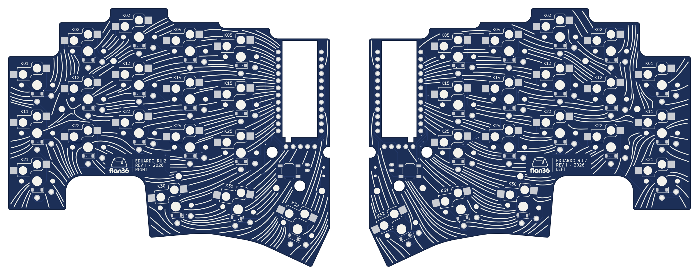
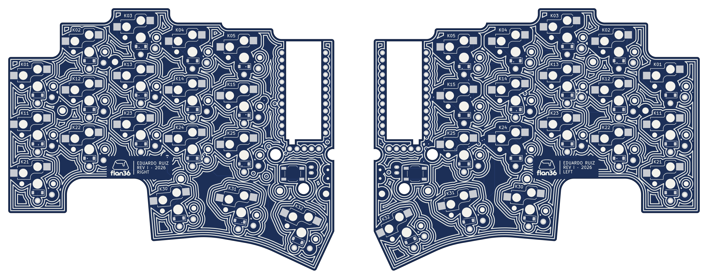
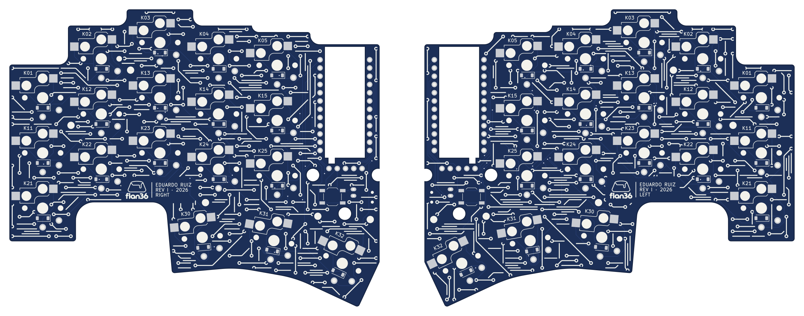
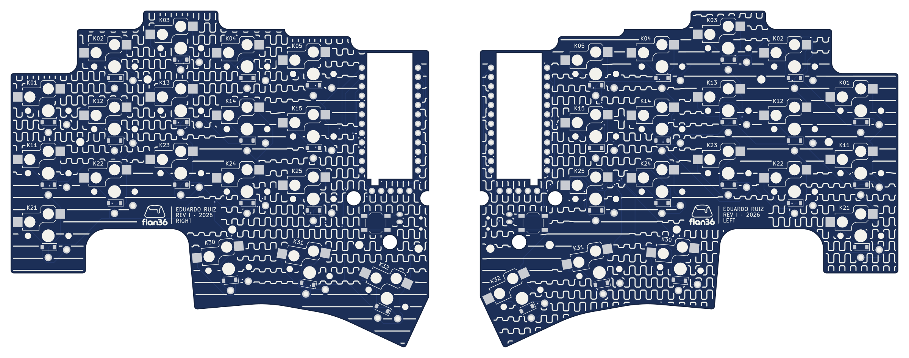
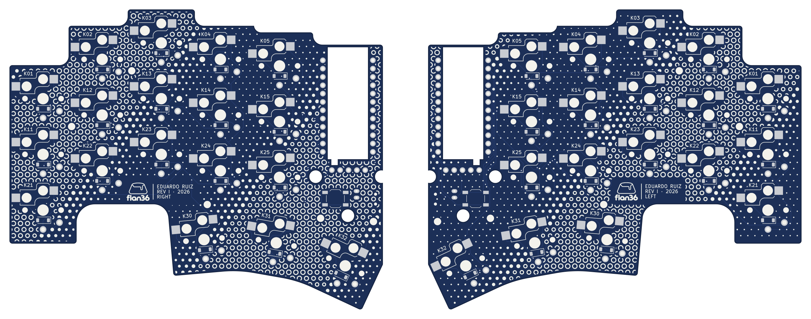
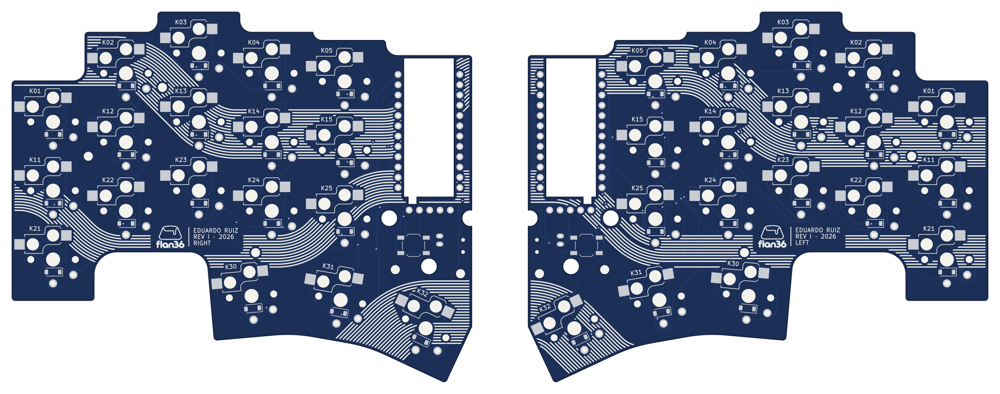
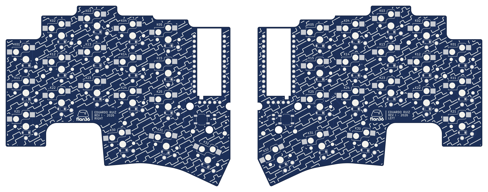

# Silkscreen R2 — all-over circuit patterns

**01 Campo is installed** on both revI boards (2026-10-17, [receipt](../../validation/revI-silkscreen.json)); the other six remain proposals. Seven one-ink patterns that cover the whole back (socket side) of both revI boards. Each is drawn once on a shared sheet — both halves seen from below, controller sides adjacent — so the composition runs continuously across the pair.

R2 replaces [R1](../silkscreen-r1/): the owner wanted full-board patterns in the style of the Duetto sheets, not accent lines. After review the owner kept only Meandro and Vías; [R3](../silkscreen-r3/) continues with kumiko and wagara.

| # | Pattern | Idea |
|---|---|---|
| 01 | **Campo** (installed) | Evenly spaced electric field lines from each controller (source) to its 18 keys (sinks). |
| 02 | **Aislamiento** | Four isolation-milling passes, 0.80 mm apart, around every pad, hole, part and edge. |
| 03 | **Ruteo** | Auto-router texture: long octilinear traces with 45° bends, ending in via rings. |
| 04 | **Meandro** | Rows of length-tuning serpentines whose amplitude swells and dies in slow waves. |
| 05 | **Vías** | Via stitching as a halftone: rings that shrink to dots along a diagonal wave. |
| 06 | **Bus** | Three wide buses (12–23 conductors) crossing both halves with concentric 45° bends. |
| 07 | **Señal** | Diagonal digital waveforms; every row spells the ASCII bits of `flan36`. |









Previews: navy mask, right half (left tile) and left half (right tile) from below, real pads and holes. The back keeps every existing legend (K01–K32, socket and diode outlines) and adds the R1 maker's plate — logo, `EDUARDO RUIZ`, `REV I · 2026`, `RIGHT`/`LEFT` — in a cleared cartouche under K23.

## Print rules

- Pattern strokes 0.30 mm. After clipping, no two separate strokes are closer than 0.24 mm and no piece is thinner than 0.17 mm.
- Halos: 0.30 mm to pads, mask openings and existing legends; 0.35 mm to holes; via copper + 0.20 mm; 0.55 mm to the board edge and internal cutouts; part bodies (clustered pads and outline) are left clear.

## Verification (`check.json`)

For all 14 boards (7 patterns × 2 halves): zero overlap with the R1 fabrication keepouts, KiCad 10.0.6 DRC on a scratch copy reports **0 violations and 0 unconnected**, and the saved board read back matches within 0.25 mm² (KiCad re-rendering its own text). Not checked: the fabricator's preview and the printed result.

## Reproduce

Run on boards without installed art, for example a checkout of `4e1bdb2`; the script refuses boards that already carry a `silkscreen-art` group.

```sh
python3 -m venv .venv && .venv/bin/pip install -r tools/requirements-silkscreen.txt
.venv/bin/python tools/prepare_silkscreen_r2.py --render3d
```

`--only campo,bus` limits the run; `--render3d` ray-traces each half from below into the ignored `build/silkscreen-r2/`, which also holds every mask colour (navy, green, black, purple, white), the scratch boards and DRC reports.

To install an R2 pattern: `python3 tools/install_silkscreen.py --proposal r2 --pattern <name>` (add `--replace` over an installed one), then rerun `tools/check_routed_pcb.py` (KiCad Python) and `tools/export_fabrication.py`.

These outputs come from `4e1bdb2`. Later generator fixes (R3) trim clipped strokes locally instead of dropping them and repair invalid art without losing area, so a rerun fills a few gaps the committed sheets show.
