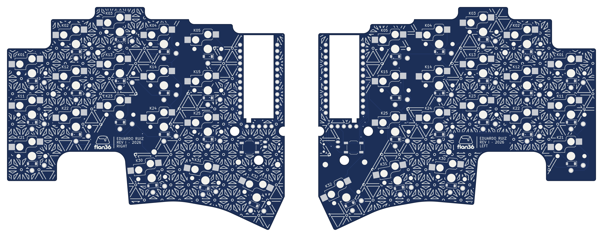
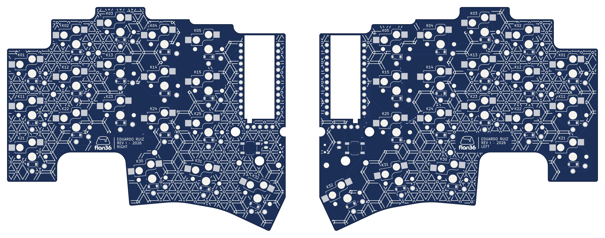
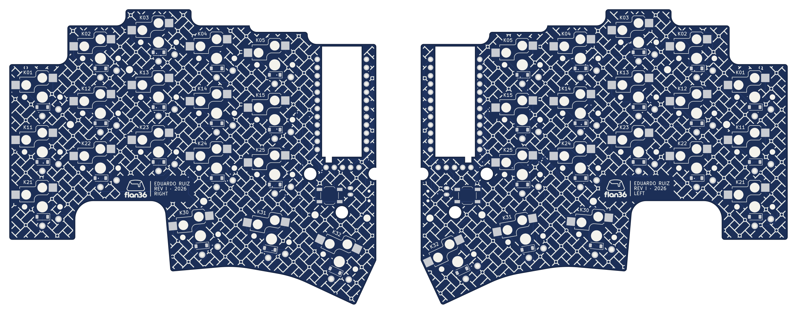
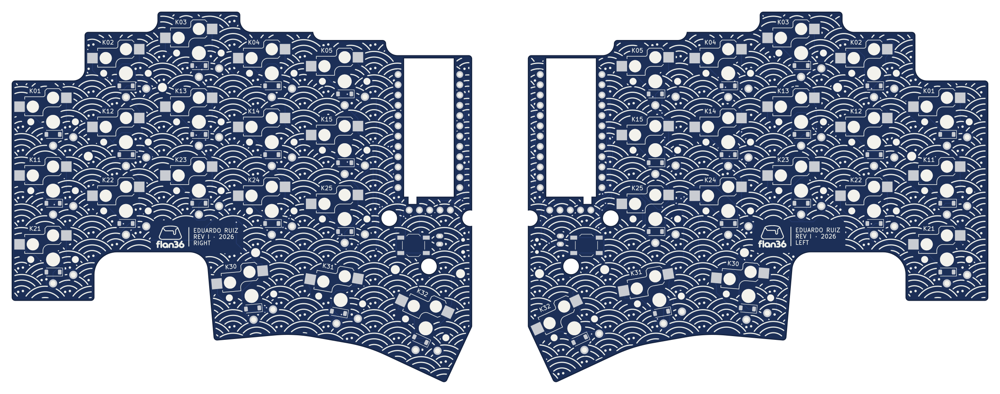
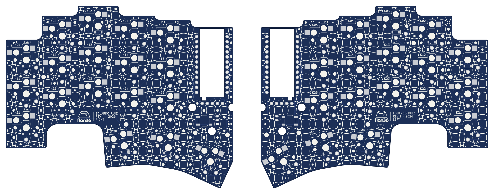
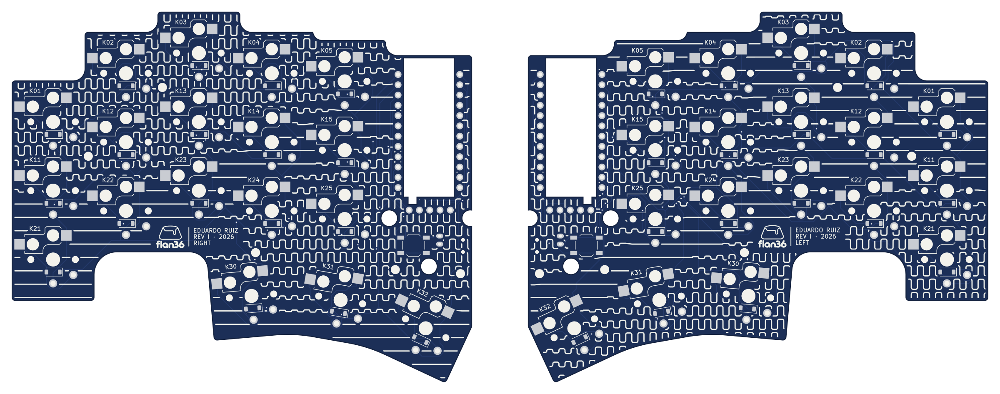
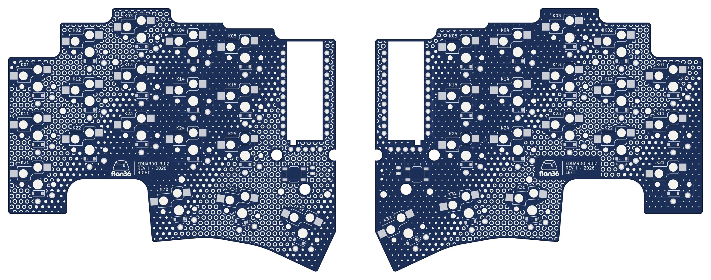

# Silkscreen R3 — kumiko and wagara

**Six of these are editions** (all except Shippō): each has its own fabrication package, see [editions](../../docs/electronics.md#editions) and `tools/export_editions.py`. The previews below predate the Flan signature; the edition previews in `docs/images/editions/` show the shipped composition.

The owner kept only Meandro and Vías from [R2](../silkscreen-r2/) and asked for kumiko and traditional Japanese patterns. R3 adds five of them in PCB language and carries the two favourites. Each pattern covers the back (socket side) of both revI boards as one composition across the pair, seen from below with the controllers adjacent. 

| # | Pattern | Idea |
|---|---|---|
| 01 | **Asanoha** (recommended) | Kumiko hemp-leaf on a triangular jigumi, slats drawn by their outline. The Vías halftone wave decides per triangle: open, frame only, or full spokes. Every joint is a via. |
| 02 | **Kikkō** | Hexagonal kumiko: shells stay open, take a mitsukude (three spokes) or a six-spoke star along the same wave; joints and star centres are vias. |
| 03 | **Sayagata** | The Japanese key fret: interlocking manji as one continuous meander on the diagonal, a via at each manji centre. |
| 04 | **Seigaiha** | Overlapping fans of concentric traces with a row of via stitching and a centre via. |
| 05 | **Shippō** | Interlocking circles; a via where four arcs meet, flower-centre dots that swell with the wave. |
| 06 | **Meandro** | Carried from R2: rows of length-tuning serpentines whose amplitude swells and dies. |
| 07 | **Vías** | Carried from R2: via stitching as a halftone. |









Previews: navy mask, right half (left tile) and left half (right tile) from below. Every existing legend is kept; the maker's plate sits in a cleared cartouche under K23.

## Print rules

- Kumiko slat outlines 0.22 mm on 1.0–1.05 mm slats; other strokes 0.24–0.30 mm. After clipping, no two separate strokes are closer than 0.24 mm and no piece is thinner than 0.17 mm.
- Halos: 0.30 mm to pads, mask openings and legends; 0.35 mm to holes; via copper + 0.20 mm; 0.55 mm to edges and cutouts; part bodies left clear.

## Verification (`check.json`)

The boards carry Campo, so the pipeline first removes the installed `silkscreen-art` group. The resulting boards are byte-identical to the routed revI boards (`sources`), and every check runs on them. For all 14 boards: zero overlap with the fabrication keepouts, KiCad 10.0.6 DRC on a scratch copy reports **0 violations and 0 unconnected**, and the saved board reads back within 0.24 mm² (KiCad re-rendering its own text). Not checked: the fabricator's preview and the printed result.

## Reproduce and install

```sh
python3 -m venv .venv && .venv/bin/pip install -r tools/requirements-silkscreen.txt
.venv/bin/python tools/prepare_silkscreen_r3.py --render3d
```

To replace the installed pattern: `python3 tools/install_silkscreen.py --proposal r3 --pattern <name> --replace`. It validates both halves first, removes the installed group, checks that each board is back to the routed base, then injects. Afterwards rerun `tools/check_routed_pcb.py` (KiCad Python) and `tools/export_fabrication.py`.
