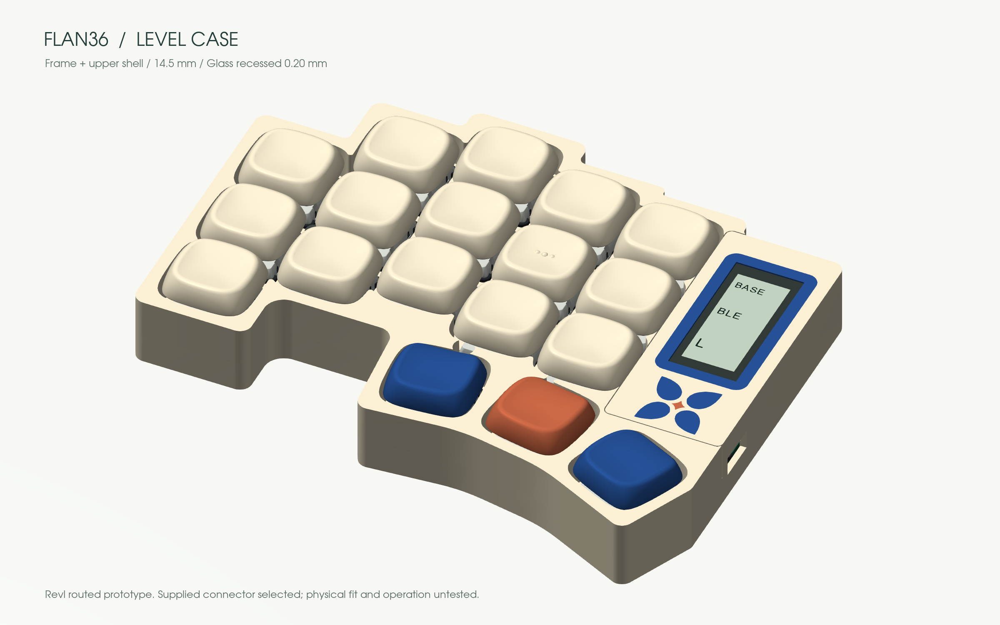

# Floor-mounted battery and level case

**Current supplied-connector stack:** the frame and Level upper shell reach **14.50 mm**. The nice!view PCB underside is **12.40 mm** and its glass top **14.30 mm**, recessed **0.20 mm**. The display uses the **7.00 mm socket/header pair supplied with nice!view**. Raising the display and frame by 0.91 mm supersedes the lower Samtec study; the main PCB, controller, battery and keys retain their positions. Heights start at the case underside and exclude feet.

| Current datum | Z / separation |
|---|---:|
| Battery underside | 1.40 mm, directly on the case floor |
| Main PCB top | 5.40 mm |
| nice!nano PCB underside | 8.20 mm; 2.80 mm above the main PCB |
| nice!view PCB underside | 12.40 mm; 7.00 mm above the main PCB |
| Display glass top | 14.30 mm |
| Frame and Level upper shell | 14.50 mm |
| Selected flat KLP keycap top | About 17.87 mm, unchanged |

The five-pin contact row retains the official **1.3 mm end offset**, and the whole display mating chain remains shifted 0.20 mm toward the frame center. The current connector and solder-clearance instructions are below. [Approved frame designs](frames-extra.md).



The [current digital delivery receipt](../validation/revI-stock-display-delivery.json) binds the native CAD, exports, KiCad models, viewer, renders and [six complete print-kit checks](../validation/revI-stock-print.json). The independent saved-file checks passed on both halves. Physical assembly and operation remain untested.

## Historical Level and R4 dimensions

The following table records the earlier Level installation, **not the current purchasing stack**. That prototype brought the frame, glass and Level upper shell to 13.39 mm, lowering the frame by 1.41 mm from the previous 14.8 mm design. The subsequent R4 adjustment raised the frame/Level roof to **13.59 mm**, leaving the glass at **13.39 mm** and a 0.20 mm recess. Both used the proposed lower connector geometry, now superseded.

| Part | Previous Z | New Z |
|---|---:|---:|
| Battery underside | 2.00 mm | 1.40 mm, directly on the case floor |
| Battery cage roof | 6.20–6.80 mm | 5.60–6.20 mm |
| nice!nano PCB underside | 8.80 mm | 8.20 mm |
| nice!view PCB underside | 12.40 mm | 11.49 mm |
| Display glass top | 14.30 mm | 13.39 mm |
| Frame and Level upper shell | 14.80 mm frame | 13.39 mm |
| Selected flat KLP keycap top | 17.87 mm | 17.87 mm, unchanged |

The battery locator now has an open bottom. Its walls locate the cell; they add no layer below it. The cage feet stay captured under the PCB. Both Adafruit 1570 and 301230 retain their own cell and cable geometry. The stored cable loops descend with the cell and rise back to the unchanged battery connector.

## Level case

Choose **Level** in the case explorer. Its upper shell hides the switch housings from the sides and meets the display frame at the same height. The Flan36 key centers, angles and outer silhouette remain unchanged.

The shell and original 1.3 mm switch-retaining plate form one removable part. It uses the same three plate screws, reached from above after removing the caps. The magnetic display frame remains independently removable. There are no new perimeter bosses or raised decorations.

The upper openings reserve all 28 currently admitted KLP variants and their allowed rotations over the full 3.5 mm travel envelope. The configurator still checks the chosen cap-to-cap and cap-to-frame arrangement. Thin intervening webs are merged into larger openings.

When **Match frame** is enabled, the Level upper shell, base and frame share a color. Turn it off to color them separately. Existing Solid, Color rim and Terrace options remain available.

## Supplied display connector

Use the socket/header pair supplied with each nice!view: a **5 mm socket and 2 mm header insulator give 7.00 mm nominal board separation**. A separate connector purchase is unnecessary. [Supplier connector reference](https://typeractive.xyz/products/5-pin-sockets).

The male header's **short solder tails enter the display PCB**; its **long mating posts enter the socket**. Trim only the free display solder tails to **at most 0.30 mm above the PCB**, keeping the complete solder-joint envelope within **0.50 mm**. Do not trim the mating posts. The main-board socket's free solder tails must stay within **1.00 mm below the main PCB**. The open service well exposes the recessed contact row and local underside relief clears the display PCB. Decorative inlays retain their backing requirement and stop where that backing is unavailable.

The [nice!view drawing](https://nicekeyboards.com/docs/nice-view/pinout-schematic/) places the contact row 1.3 mm from the end. This corrects the older 2.4 mm model misalignment. Supplied-part tolerances, soldering and printed fit still require inspection during assembly; this is not a claim of physical acceptance.

For the controller, cut the selected **315-43-164-41-003000** Mill-Max strip into four 12-contact strips and use **3320-0-00-15-00-00-03-0** round pins. Hold the nice!nano PCB underside on its printed support at **Z8.20 mm**, 2.80 mm above the main PCB, before soldering. Loose pin length does not establish that separation. [Purchasing BOM](parts.md#removable-connectors).

## Historical lower-connector study

The former nominal connector pair was **Samtec SLW-105-01-L-S + TLW-105-06-G-S**: a 4.57 mm socket and 1.52 mm header insulator proposed 6.09 mm board separation. Its 2.67 mm mating post falls within the socket's published 2.16–2.92 mm insertion range. See the [SLW drawing](https://suddendocs.samtec.com/catalog_english/slw.pdf) and [TLW drawing](https://suddendocs.samtec.com/catalog_english/tlw_th.pdf).

That study modeled trimmed display solder tails and introduced the service well retained by the current design.

**The Samtec substitution was not qualified and is no longer recommended for purchase.** The finished nice!view hole diameter is not dimensioned in the available drawing. The study assumed a 0.9 mm hole; the nominal 0.025-inch square post has a 0.898 mm diagonal, leaving no useful tolerance allowance. The current design uses the supplied connector instead. Do not enlarge or drill a purchased display based on the historical model.

13.39 mm was the initial Level prototype target, not a claim of an absolute physical minimum. Further reductions require a different qualified connector or module arrangement. Actual socket engagement, soldering, printed strength, battery insulation, cable flex and service forces still need a physical prototype. The [current PCBs are routed](electronics.md); this geometry is still not a physically qualified build kit.

[Level geometry delivery](../validation/revI-level-delivery.json) is a historical receipt for the floor/Level installation. Its hashes identify that historical snapshot; later adjustments supersede its native and derived files. [Cap direction checks](../validation/revI-cap-rows.json) cover the subsequent orientation fix. [Earlier viewer reliability checks](../validation/revI-reliability.json) and the [approved-frame delivery](../validation/revI-approved-frames.json) retain their original snapshot hashes. Openings preserve cap travel, so parts of the switches can still be visible from above between keys; the Level perimeter conceals their bodies from the sides.

## Reproduce the current supplied-connector installation

The stock-display migration starts from the preserved source at commit `4d7a52b4a19ef7779524e9ffab901d8fd33492ed`. Extract that source into an ignored build directory so the adopted source is not overwritten:

```sh
mkdir -p build/stock-display/source
git show 4d7a52b4a19ef7779524e9ffab901d8fd33492ed:mechanical/revI/Flan36.FCStd > build/stock-display/source/Flan36.FCStd
python3 tools/freecad/run_macos.py tools/freecad/install_stock_display.py \
  --source build/stock-display/source/Flan36.FCStd \
  --output build/stock-display/Flan36.FCStd
python3 tools/freecad/run_macos.py tools/freecad/restore_stock_display_appearance.py \
  --source build/stock-display/Flan36.FCStd \
  --baseline build/stock-display/source/Flan36.FCStd
python3 tools/freecad/run_macos.py tools/freecad/check_stock_display.py \
  --source build/stock-display/Flan36.FCStd \
  --baseline build/stock-display/source/Flan36.FCStd \
  --report build/stock-display/stock-readback.json
FLAN36_EXPORT_OUT=build/stock-display \
FLAN36_EXPORT_METADATA=build/stock-display/revI.json \
FLAN36_EXPORT_REPORT=build/stock-display/mechanical.json \
python3 tools/freecad/run_macos.py tools/freecad/export_revI.py
python3 tools/adopt_stock_display.py build/stock-display --dry-run
```

The migration retains the controller, battery and routed PCB positions and installs the supplied 7.00 mm display connector stack. Appearance restoration uses the original named view properties and verifies that geometry is unchanged. The readback and exporter check the saved candidate before adoption.

The adopter requires the repository still to contain the same baseline used for migration. In a baseline checkout with these migration tools, remove `--dry-run` only after it passes; then run the [viewer and render commands](cad.md#rebuild-the-reference). In an already updated checkout, use the staged reports for reproduction and do not replace the adopted files with a second migration. This reproduces the digital assembly; physical fit and operation remain separate checks.

After rebuilding the viewer, run `python3 tools/check_stock_print.py`. It uses the production print-kit generator for all six current frames with the Level case, then compares every STL byte and every registered 3MF triangle with the native exports. Kits and the receipt regenerate under ignored `build/stock-print/`; this checks digital files, not browser downloading or slicer operation.

## Reproduce the historical Level installation

Start from the preserved pre-level source at commit `9ab4b181f77d0f3ffc28bda0cb3c059006713c89`. Export that file into an ignored build directory, then run:

```sh
python3 tools/freecad/run_macos.py tools/freecad/install_level_stack.py \
  --source build/level-case/source/Flan36.FCStd \
  --output build/level-case/candidate/Flan36.FCStd
python3 tools/freecad/run_macos.py tools/freecad/check_level_stack.py \
  --source build/level-case/candidate/Flan36.FCStd \
  --output build/level-case/candidate/geometry-check.json
```

Use a new output directory. The installer preserves the input and checks native save/reopen, unchanged key meshes and transforms, and idempotence. A saved candidate alone is not acceptance. The delivery receipt records the subsequent collision, travel, service, export and viewer checks.

Follow the [CAD export and viewer commands](cad.md#rebuild-the-reference) after adopting an accepted candidate. Run `node viewer/level-check.cjs` before `python tools/check_print_kit.py` to include the Level shell kit alongside the nine existing kit checks. `python tools/check_level_delivery.py` reproduces the historical Level delivery binding only at that snapshot; newer viewer changes require their own scoped receipt. Use `node viewer/reliability-check.cjs` for the current viewer state transitions. After publication, `python tools/check_public_delivery.py COMMIT` checks the anonymous source archive and live viewer against that exact commit.

`build/level-case/` holds ignored, reproducible candidates, diagnostic logs and browser test output. The committed installer/checkers above recreate the delivery artifacts; the installation and review receipts preserve the decisions and superseded candidate findings.
