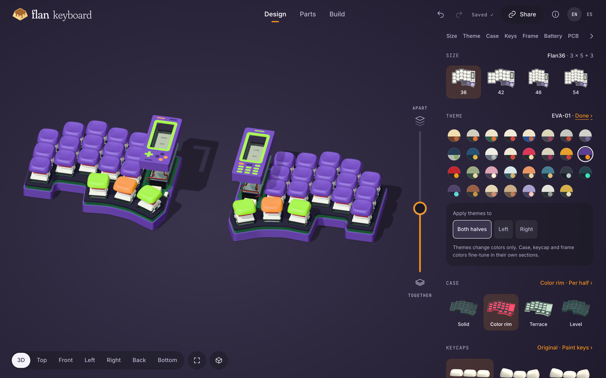

# Make it yours

Open [the 3D explorer](https://flankbd.com/explore/) and pick a swatch under **Design → Theme**. The 31 presets use named Bambu Lab or Polymaker filaments for the case, frame and keycaps; **Per half** applies one to a single half.

All five finger columns share the same base color. Each thumb gets its own coordinated accent, mirrored between halves. In **Caps → Colors**, eight independent palettes use the same filament catalog: **Sunset rows** colors whole finger rows and **Arcade thumbs** puts its bright accents on the three thumbs. **Original** keeps matching green thumbs.

1. Choose **Both halves**, **Left** or **Right**.
2. Pick a theme. It changes colors while preserving shapes, keycap geometry and installed covers.
3. In **Base**, edit the base/rim and key plate. In **Frame**, edit the body and flush inlays. Every color also has a HEX field and **Copy** button.
4. Enable **Match frame and rim** for continuous color. Editing either linked color updates the other; with Level, the upper shell joins the linked base and frame color.
5. Use **Build → Print the parts → Download one 3MF**; the complete kit also carries your keycaps.

The [six installed approved frames](frames-extra.md) have four solid-color regions. Talavera is the default. Each design has a matching global palette; **Restore design colors** restores the selected frame palette.

Changing shapes preserves customized colors. An untouched original design adopts the new shape's original palette. Frame and theme changes preserve cover visibility and the current inspection.

## Keep your configuration

Selections save automatically on this device. **Save configuration** downloads JSON for another browser or the FreeCAD configuration macro. JSON carries explicit colors, shapes and cover installation, so a preset name never changes an old saved design. Legacy JSON still loads.

To update an existing design to these colors, select its theme or cap palette again. Custom colors remain editable per key, row or column.

The [current collection checks](../validation/revI-approved-selection.json) cover native material exports, configuration migration and viewer behavior. The earlier [thumb-palette receipt](../validation/revI-thumb-themes.json) records the previous palette set.

Eye, Solo, camera and exploded views are inspection controls. They do not remove parts from the print kit. Unchecking **Printed display cover** does remove that cover and its three frame magnets from the selected assembly.

## Printable parts and joining

**Shells** exports each selected case, key plate and installed frame. For Level, the switch-retaining plate and raised upper shell export as one removable part. The **Complete kit**, the default, also includes the open-bottom battery locator, cage, controller support and display support, and a printed washer for each M2 × 6 fastener: three per half on Flan36, one or three more on the larger sizes. It carries your keycaps too: each KLP Lamé file the design uses, unchanged, with `Keycaps/plan.csv` and a per-color list in the READ-ME. The combined 3MF places every selected keycap in the requested quantity. Both the online and offline explorer include the meshes. Commercial parts are excluded; [keycap fit guidance](customize.md#klp-lamé) remains separate.

Open the single 3MF **as a project** in Bambu Studio. Select **Shells + frame** for just the bases, switch plates and installed display frames. Under **Printer**, choose your Bambu model and the installed **Nozzle** before downloading. The combined 3MF references the matching factory machine, standard process and PLA profiles in Bambu Studio. Bambu PLA Basic and Matte use their respective profiles. Other PLA spools use Generic PLA with the selected color. In Studio, confirm the AMS mapping and slice. **Generic 3MF** lets you choose the bed size and configure your printer in the slicer. The magnets glue in after printing. The case follows Flan’s PCB and pinky stagger. A 36-key Corne uses a different layout.

In **Design → Theme → Filaments for this theme**, the preset already has assigned spools. Open the panel to pick a substitute, or apply suggestions to custom colors. For a custom palette, use **Choose filament** in the base, frame or keycap color editor. Search by commercial name, filter by range or color family, and compare the nearest alternatives. The catalog uses manufacturer HEX values from [Bambu PLA Basic](https://us.store.bambulab.com/products/pla-basic-filament), [Bambu PLA Matte](https://us.store.bambulab.com/products/pla-matte), [Polymaker Panchroma Basic](https://shop.polymaker.com/products/panchroma-pla) and [Panchroma Matte](https://shop.polymaker.com/products/matte-pla). The 2026-11-20 US stock snapshot qualified 132 one-kilogram colors sold on a spool or as a refill. Each preset matches its original colors to eligible manufacturer swatches in OKLab. The case and frame keep the nearest body color. The other colors minimize the combined squared distance while keeping frame artwork at least 1.5:1 against its body and preserving distinct colors within each frame and keycap palette. Repeated design colors share a spool across parts. The source palettes retain the original design colors; the picker also includes other catalog colors for people who already own them. Compare physical swatches in your light. **Save theme** downloads your colors and spool selections. **Open theme** applies them to another Flan while preserving its geometry. Sharing the full design also preserves spool assignments and print method.

| Print method | What the 3MF contains |
| --- | --- |
| AMS · multicolor | Registered frame artwork. Each plate uses up to four spools. Map the colors for the plate you intend to print. |
| AMS · by object | Single-color objects, a smooth frame, and sequential printing. Check toolhead clearance in your machine profile before slicing. |
| One spool per plate | Each plate groups parts by spool. Frames use the fused mesh in their body color. Reload between plates with either a manual feeder or an AMS. |

Select a square bed of 180, 220 or 256 mm and review the arrangement on your actual printer. Color-matched designs and the two single-color methods reuse the base spool for internal supports. The 3MF includes a plate-to-spool list under `Metadata/Flan/Filaments.csv`. **Individual files · ZIP** also carries the project at its root. Both the combined and individual 3MFs lay the case floor and switch plates flat. Frames are face down: on Game Boy, the decorated face has about 918 mm² of bed contact versus 151 mm² at the opposite face. A single rigid rotation preserves the artwork and all color volumes. The bed texture will appear on the finished frame. The battery cage rests on its top, the display sled on its long side, and washers lie flat. Supports are enabled on keycaps and display sleds in the combined project. Keycaps keep the touch surface up and the stems accessible for a fit check. Check one printed key for fit before printing a full set. The sockets stay open on the mating faces. Glue the magnets after printing.

The [historical support study](slim-mount-study.md) includes experimental plates with integrated washers and bases with integrated saddles. These reduce loose parts, not height. They predate the current floor-mounted battery and Level shell; their separate downloads are comparison geometry, not replacements in the current print kit.

- The structural case uses three M2 × 6 and two M2 × 4 screws per half. Tap the 1.7 mm pilot holes to M2.
- Each installed frame uses three glued-in Ø2 × 4 mm axial magnets, paired with three Ø2 × 3 mm axial magnets retained in its base. Use existing stock; each extra pair of frames needs six more Ø2 × 4 mm magnets.
- Dry-fit one attracting pair. Mark the same exposed pole in every base and the opposite in every frame. Let the adhesive cure with the parts separated.
- Printed glue-in meshes and the fit samples are available under [mechanical/glue-in](../mechanical/glue-in). The original revision I CAD uses enclosed pockets.
- There is no clip variant yet. A color or theme does not change the joining method.

The ZIP includes the selected geometry, JSON and a manifest with quantities, source hashes, units, colors and joining details. STL coordinates are the unchanged native assembly coordinates, in millimetres. Prepare orientation, supports, tolerances and your actual filament in the slicer.

This is prototype geometry. Print [fit coupons](cases.md) before a complete set. Neither magnets, tapped threads nor the whole assembly have physical acceptance yet.

## Color 3MF status

Decorated frames export as **multipart 3MF assemblies**: one recessed shell and separate closed volumes for the three inlay colors. All parts share one transform, so the inlays stay registered to their pockets. All colors finish at the **14.50 mm** roof. The five approved R4 frames use 0.4 mm surface inlays with 1.0 mm backing outside the display relief, a 0.865 mm through-color collar and a 0.4 mm through-color pin cover. Rejected shapes are excluded from the active viewer and its print kit. Hanafuda uses its exact approved R8 paths with the same construction. See the [construction rules](frames-extra.md).

These are complementary volumes for **co-printing**, not separately printed press-fit inserts. Use compatible colors of the same material and qualify their bonding on a small sample. The kit also includes the original aligned material STLs and a fused single-material STL. The fused file has a plain surface and cannot reproduce the color pattern by geometry alone.

The generic files contain no printer or process profile. The manifest records the common bed translation, colors, material roles and source hashes.

**Check the filament assignments in Bambu Studio.** Map **body, detail, accent and secondary** to the manifest colors and keep the material volumes together as one multipart object. Automatic palette assignment and slicer GUI save/reopen remain unverified. Inspect the sliced inlay layers before printing.

Keycaps are included in global themes. For independent colors, row/column patterns and portable personal palettes, use [Caps → Colors](customize.md#keycap-colors). Selecting another keycap shape preserves its assigned color.

The profile index comes from Bambu Studio 2.9.1.70 (BBL 02.09.00.74). Regenerate it with `python3 tools/build_printer_presets.py /Applications/BambuStudio.app/Contents/Resources/profiles`. The generator checks machine, nozzle, process and filament compatibility against the vendor manifest. [Bambu Studio system profiles](https://github.com/bambulab/BambuStudio/tree/v02.09.01.70/resources/profiles/BBL)
