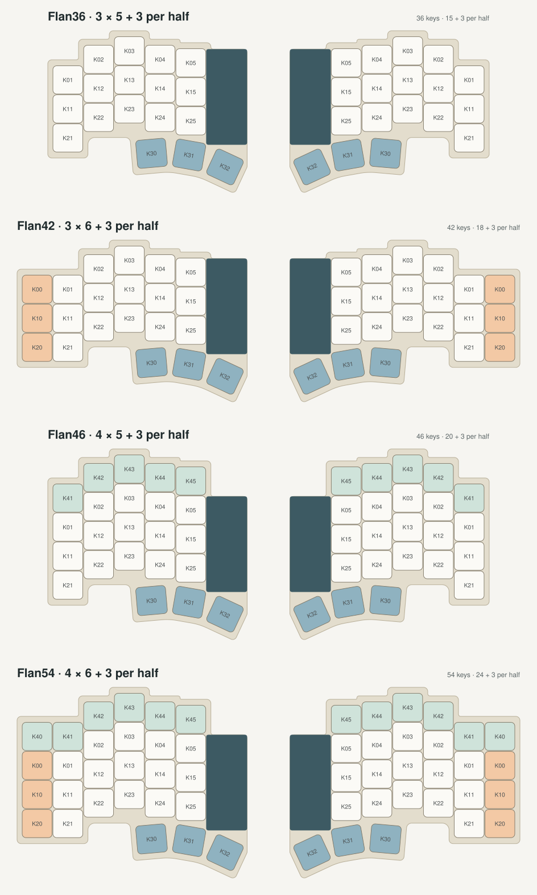
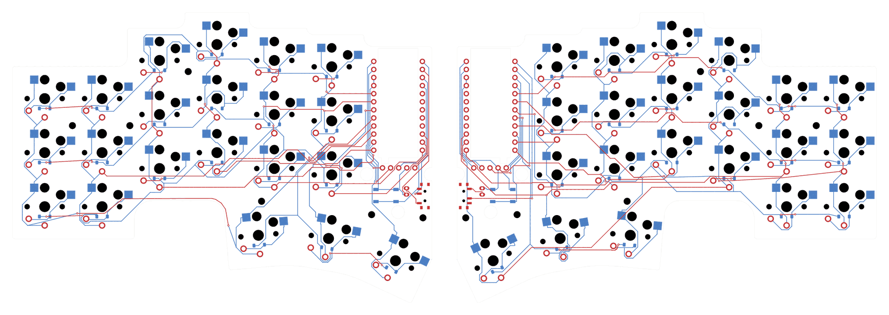

# The Flan family

**Flan36 is built. Flan42 has routed PCBs that pass DRC, ERC and schematic parity, with Gerber packages; its case, firmware and viewer support come next. Flan46 and Flan54 have generated layouts, matrices and preliminary case outlines.**



| Variant | Per half | Keys | Adds per half | Case per half | Matrix |
|---|---|---|---|---|---|
| **Flan36** | 3 × 5 + 3 | 36 | — | 116.75 × 94.57 mm | 4 × 6 |
| **Flan42** | 3 × 6 + 3 | 42 | outer pinky column K00, K10, K20 | 134.75 × 94.57 mm | 4 × 6 |
| **Flan46** | 4 × 5 + 3 | 46 | number row K41–K45 | 116.75 × 111.57 mm | 5 × 6 |
| **Flan54** | 4 × 6 + 3 | 54 | both, plus K40 | 134.75 × 111.57 mm | 5 × 6 |

## Rules

- **Nothing in Flan36 moves.** Every Flan36 key, the thumbs and the electronics bay keep their exact centres and angles; the larger variants only add keys, so a saved Flan36 design maps onto them key for key.
- **Outer pinky column:** the K00/K10/K20 centres of the pinned [Piantor boards](../sources/piantor/), which Flan36 left out, level with column 1. Piantor turns those footprints 180°, which moves only the hot-swap socket; Flan keeps every key upright.
- **Number row:** one 17 mm row pitch above each column's top key, keeping the column stagger.
- **Refs follow the matrix:** `K<row><column>`. Column 0 is already wired (thumb K30 uses it), so the outer column needs no new GPIO. The number row is matrix row 4 and needs one row GPIO per half; free pins are D15 and D18–D21 on the left and D2–D6 on the right, to be chosen while routing.
- **Outline:** the revI rule in [`tools/outline.py`](../tools/outline.py): column plateaus 4.75 mm beyond each switch cut, the bay flank, offset thumb faces and local tangent rounds. Flan36 reproduces the revI control vertices exactly.
- **Spacing:** every new key keeps at least Flan36's own finger-key spacing: 0.5 mm cap to cap, 3.0 mm cut to cut and 0.25 mm cap to bay. The closest new key to the bay, K45, has 0.79 mm.

Layouts, matrix transforms, outline control vertices and spacing are in [`design/variants.json`](../design/variants.json). Regenerate and check them, including the Flan36 regressions against revI and the shipped firmware transform:

```sh
python3 tools/build_variants.py      # needs Shapely (tools/requirements-silkscreen.txt)
```

## Flan42 PCB



[`hardware/flan42/`](../hardware/flan42/) holds two KiCad 10 projects derived from the routed, signed revI boards. Every Flan36 footprint, track, via and hole, the bay, the battery opening and both cutouts are unchanged; the checker compares them with revI.

- **Added per half:** K00, K10 and K20 (Choc v1 hot-swap, copies of K01/K11/K21) at the variant centres, and D00, D10 and D20 (SOD-123, 1N4148W). They are wired col2row on ROW0–ROW2 and COL0, with no new GPIO.
- **Fastener H6:** an M2 hole one column outward from H1, at (20.7, 37.5) mm on the left and (139.3, 37.5) mm on the right. Without it, the outer edge would reach 52.54 mm from the nearest fastener; Flan36's worst key-side point is 41.65 mm, and H6 restores exactly that.
- **Outline:** the Flan42 case outline under revI's board rule: a 1.65 mm inset, the LCD-flank notch and revI's cutouts. The board is 131.45 × 91.27 mm per half.
- **Routing:** each added key copies its row neighbour's own routing, translated 18 mm. The grid router [`complete_pcb_routes.py`](../tools/complete_pcb_routes.py) routes the row links and the COL0 link; [`smooth_routes.py`](../tools/smooth_routes.py) then straightens them.
- **Silkscreen:** the Flan signature and credit sit in the same free back rectangles as revI. The tool rechecks them on these boards. The back still reads REV I because Flan42 keeps revI's electronics; the front legend reads FLAN42. The six back-pattern editions are not generated for Flan42 yet.

**Checks.** KiCad 10.0.6 runs DRC at all severities with all track errors, schematic parity and ERC. Each half has 0 violations and 0 unconnected items. The checker reads all 281 physical pads and 21 matrix keys per half. It confirms that each added footprint is an exact translated copy of its template, and that the outline equals revI's minus its outer edge plus Flan42's. Negative controls reject a wrong pad net, a disconnected row and a key moved 0.1 mm. A readback of the Gerber and drill files matches the PCB's 676 outline segments and every plated and non-plated hole.

**Packages:** [`flan42-left-prototype.zip`](../hardware/flan42/fabrication/flan42-left-prototype.zip) and [`flan42-right-prototype.zip`](../hardware/flan42/fabrication/flan42-right-prototype.zip), exported with revI's options. Receipts: [build](../validation/flan42-pcb.json), [routing](../validation/flan42-routing.json), [negative controls](../validation/flan42-routing-negative.json), [signature](../validation/flan42-signature.json) and [fabrication](../validation/flan42-fabrication.json).

**Physical fit is untested.** No Flan42 case, firmware shield or keycap qualification exists yet. Check the board against the case before ordering. Flan42 also inherits Flan36's open hardware tests.

Rebuild from revI with KiCad 10.0.6. `$SILK_PY` is a Python with [`tools/requirements-silkscreen.txt`](../tools/requirements-silkscreen.txt). `$KICAD_PY` is KiCad's Python with Shapely, NumPy and SciPy. The board builder refuses to overwrite existing boards.

```sh
$SILK_PY tools/build_variant_profiles.py --variant flan42            # design/flan42-profiles.json
$KICAD_PY tools/build_variant_pcb.py --variant flan42                # hardware/flan42, unrouted additions
$KICAD_PY tools/route_variant_keys.py hardware/flan42/flan42-left.kicad_pcb left
$KICAD_PY tools/route_variant_keys.py hardware/flan42/flan42-right.kicad_pcb right
$SILK_PY tools/install_signature.py --variant flan42
$KICAD_PY tools/check_routed_pcb.py --variant flan42
$KICAD_PY tools/test_routing_gate.py --variant flan42
python3 tools/export_fabrication.py --variant flan42
```

## Next stages

Each stage applies to Flan42, Flan46 and Flan54. Flan42 is the natural first build: it adds keys to an existing matrix column and needs no new pin.

1. **PCB:** Flan42 is done (above). Flan46 and Flan54 need the row-4 net and a chosen pin, then routing, checks and Gerber packages. The builder and router handle the outer column only. The six silkscreen editions still need to be generated for each variant board.
2. **Case:** FreeCAD bodies from the variant outline with the same stack, bay, frames, magnets and batteries; new fastener positions for the larger plates (Flan42's H6 is already on its PCB); fit coupons.
3. **Firmware:** a ZMK shield per variant from its matrix transform, the row-4 pin and keymaps with the number row or outer column.
4. **Keycaps:** KLP Lamé qualification for the new positions.
5. **Viewer:** a variant choice in Design, each variant's scene loaded on demand like the print kit.

None of this is physically qualified; the variants inherit Flan36's open hardware tests.
