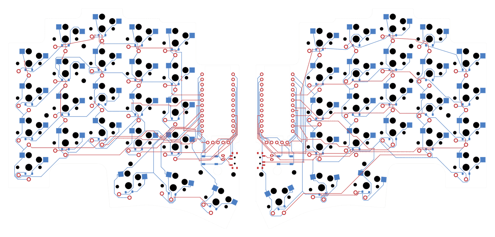
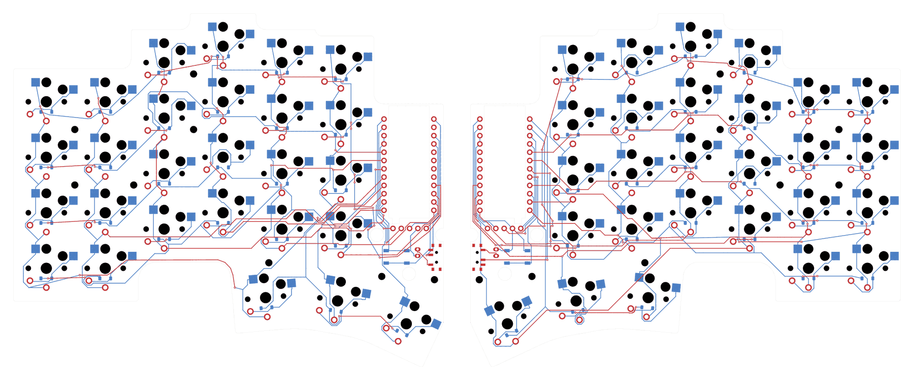

# The Flan family

**Flan36 is built. Flan42, Flan46 and Flan54 have routed PCBs that pass DRC, ERC and schematic parity, with Gerber packages; their cases, firmware and viewer support come next.**


| Variant | Per half | Keys | Adds per half | Case per half | Matrix |
|---|---|---|---|---|---|
| **Flan36** | 3 × 5 + 3 | 36 | — | 116.75 × 94.57 mm | 4 × 6 |
| **Flan42** | 3 × 6 + 3 | 42 | outer pinky column K00, K10, K20 | 134.75 × 94.57 mm | 4 × 6 |
| **Flan46** | 4 × 5 + 3 | 46 | number row K41–K45 | 116.75 × 111.57 mm | 5 × 6 |
| **Flan54** | 4 × 6 + 3 | 54 | both, plus K40 | 134.75 × 111.57 mm | 5 × 6 |

## Rules

- **Nothing in Flan36 moves.** Every Flan36 key, the thumbs and the electronics bay keep their exact centres and angles; the larger variants only add keys, so a saved Flan36 design maps onto them key for key.
- **Outer pinky column:** the K00/K10/K20 centres of the pinned [Piantor boards](../sources/piantor/), which Flan36 left out, level with column 1. Piantor turns those footprints 180°, which moves only the hot-swap socket; Flan keeps every key upright.
- **Number row:** one 17 mm row pitch above each column's top key, keeping the column stagger.
- **Refs follow the matrix:** `K<row><column>`. Column 0 is already wired (thumb K30 uses it), so the outer column needs no new GPIO. The number row is matrix row 4 and needs one row GPIO per half; free pins are D15 and D18–D21 on the left and D2–D6 on the right, to be chosen while routing.
- **Outline:** the revI rule in [`tools/outline.py`](../tools/outline.py): column plateaus 4.75 mm beyond each switch cut, the bay flank, offset thumb faces and local tangent rounds. Flan36 reproduces the revI control vertices exactly.
- **Spacing:** every new key keeps at least Flan36's own finger-key spacing: 0.5 mm cap to cap, 3.0 mm cut to cut and 0.25 mm cap to bay. The closest new key to the bay, K45, has 0.79 mm.

Layouts, matrix transforms, outline control vertices and spacing are in [`design/variants.json`](../design/variants.json). Regenerate and check them, including the Flan36 regressions against revI and the shipped firmware transform:

```sh
python3 tools/build_variants.py      # needs Shapely (tools/requirements-silkscreen.txt)
```

## Flan42 PCB


[`hardware/flan42/`](../hardware/flan42/) holds two KiCad 10 projects derived from the routed, signed revI boards. Every Flan36 footprint, track, via and hole, the bay, the battery opening and both cutouts are unchanged; the checker compares them with revI. Libraries and 3D models are revI's, referenced through `${KIPRJMOD}/../revI/`.

- **Added per half:** K00, K10 and K20 (Choc v1 hot-swap, copies of K01/K11/K21) at the variant centres, and D00, D10 and D20 (SOD-123, 1N4148W). They are wired col2row on ROW0–ROW2 and COL0, with no new GPIO.
- **Fastener H6:** an M2 hole one column outward from H1, at (20.7, 37.5) mm on the left and (139.3, 37.5) mm on the right. Without it, the outer edge would reach 52.54 mm from the nearest fastener; Flan36's worst key-side point is 41.65 mm, and H6 restores exactly that.
- **Outline:** the Flan42 case outline under revI's board rule: a 1.65 mm inset, the LCD-flank notch and revI's cutouts. The board is 131.45 × 91.27 mm per half.
- **Routing:** each added key copies its row neighbour's own routing, translated 18 mm. The grid router [`complete_pcb_routes.py`](../tools/complete_pcb_routes.py) routes the row links and the COL0 link; [`smooth_routes.py`](../tools/smooth_routes.py) then straightens them.
- **Silkscreen:** the Flan signature and credit sit in the same free back rectangles as revI. The tool rechecks them on these boards. The back still reads REV I because Flan42 keeps revI's electronics; the front legend reads FLAN42.

**Checks.** KiCad 10.0.6 runs DRC at all severities with all track errors, schematic parity and ERC. Each half has 0 violations and 0 unconnected items. The checker reads all 281 physical pads and 21 matrix keys per half. It confirms that each added footprint is an exact translated copy of its template, and that the outline equals revI's minus its outer edge plus Flan42's. Negative controls reject a wrong pad net, a disconnected row and a key moved 0.1 mm. A readback of the Gerber and drill files matches the PCB's 676 outline segments and every plated and non-plated hole.

**Packages:** [`flan42-left-prototype.zip`](../hardware/flan42/fabrication/flan42-left-prototype.zip) and [`flan42-right-prototype.zip`](../hardware/flan42/fabrication/flan42-right-prototype.zip), exported with revI's options. Receipts: [build](../validation/flan42-pcb.json), [routing](../validation/flan42-routing.json), [negative controls](../validation/flan42-routing-negative.json), [signature](../validation/flan42-signature.json) and [fabrication](../validation/flan42-fabrication.json).

**Physical fit is untested.** No Flan42 case, firmware shield or keycap qualification exists yet. Check the board against the case before ordering. Flan42 also inherits Flan36's open hardware tests.

Rebuild from revI with KiCad 10.0.6. `$SILK_PY` is a Python with [`tools/requirements-silkscreen.txt`](../tools/requirements-silkscreen.txt). `$KICAD_PY` is KiCad's Python with Shapely, NumPy and SciPy. The board builder refuses to overwrite existing boards.

```sh
$SILK_PY tools/build_variant_profiles.py --variant flan42            # design/flan42-profiles.json
$KICAD_PY tools/build_variant_pcb.py --variant flan42                # hardware/flan42, unrouted additions
$KICAD_PY tools/route_variant_keys.py hardware/flan42/flan42-left.kicad_pcb left
$KICAD_PY tools/route_variant_keys.py hardware/flan42/flan42-right.kicad_pcb right
$SILK_PY tools/install_signature.py --variant flan42
$KICAD_PY tools/check_routed_pcb.py --variant flan42
$KICAD_PY tools/test_routing_gate.py --variant flan42
python3 tools/export_fabrication.py --variant flan42
```

## Flan46 and Flan54 PCBs





[`hardware/flan46/`](../hardware/flan46/) and [`hardware/flan54/`](../hardware/flan54/) are built with the same tools and checks as Flan42. The boards are 113.45 × 108.27 mm (Flan46) and 131.45 × 108.27 mm (Flan54) per half.

- **Number row:** K41–K45 copy the top-row key of their column one 17 mm pitch up, with diodes D41–D45; Flan54 adds K40 (a copy of K01) and Flan42's outer column. They are matrix row 4, net ROW4.
- **ROW4 pin:** D15 on the left and D6 on the right, recorded in [`design/pinmap.json`](../design/pinmap.json) under `variants`; revI's pins are unchanged. Every free pin was routed on Flan46. The lowest pin gave the shortest ROW4 on each half: 188.09 mm against up to 198.22 mm on the left, and 178.58 mm against up to 188.69 mm on the right.
- **GND3 on the left:** number-row left boards use the nice!nano's other GND pins (GND1 and GND2); U1 GND3 is a no-connect. Those boards' free pins all sit in the RAW-side channel, which at the revI rules (0.2 mm tracks and clearance, 0.5 mm to the edge) already carries three tracks per layer past D10; a seventh signal misses by 0.02 mm, so ROW4 takes GND3's track's place. The module ties its GND pads together. The checker proves, independently of DRC, that J1's GND and every other GND pad still form one copper net without GND3, and a negative control that cuts J1's GND link is rejected.
- **Fasteners:** every edge point left of the bay must stay as close to a fastener as Flan36's worst key-side point (41.65 mm), or as the Flan36 edge point it extends. Flan46 adds H7, H2 one row up, at (57, 3.5) mm on the left and (103, 3.5) mm on the right. Flan54 adds H6, H7 and H8, which is H1 one column out and one row up, at (20.7, 20.5) mm and (139.3, 20.5) mm.
- **Routing:** each new key copies its template key's Krc_A routing. The grid router links the number-row columns, the ROW4 chain and the ROW4 link to the MCU, and the straightening pass cleans them up. The signature stays in revI's free rectangles.

**Checks.** DRC, ERC and parity report 0 violations and 0 unconnected items per half. The checker reads 303 physical pads and 23 matrix keys per half on Flan46, and 349 pads and 27 keys on Flan54. It also verifies the ROW4 pin, the no-connect GND3 and the single GND copper net. Negative controls reject a wrong pad net, a disconnected row, a moved key and a cut GND link. The Gerber and drill readback matches 676 outline segments and every hole. Packages are in `hardware/flan46/fabrication/` and `hardware/flan54/fabrication/`. The receipts are `validation/flan46-*.json` and `validation/flan54-*.json`.

**Physical fit is untested.** The firmware also needs ROW4 on D15/D6 before a number-row board can be used.

**Silkscreen editions.** All three variants have the six back patterns that revI offers: Asanoha, Kikkō, Sayagata, Seigaiha, Meandro and Vías. Each pattern follows its own board's outline and keys around the signature. For every edition and half, the export runs revI's print checks, DRC with parity and a readback. It also compares the Gerbers byte for byte with the base package and requires that only `B_Silkscreen` differs. The packages are in `hardware/<variant>/fabrication/editions/`, the previews in [`docs/images/editions/<variant>/`](images/editions/flan54/seigaiha.png), and the receipts are `validation/<variant>-editions.json`. Rebuild them with `$SILK_PY tools/export_editions.py --variant flan42` (or flan46, flan54) after the fabrication export.

The rebuild commands are the same as Flan42's with `--variant flan46` or `--variant flan54`. Use `build_variant_pcb.py --row4 LEFT RIGHT --output DIR` to try other pins.

## Next stages

Each stage applies to Flan42, Flan46 and Flan54. Flan42 is the natural first build: it adds keys to an existing matrix column and needs no new pin.

1. **PCB:** done for all three variants, including the six silkscreen editions (above).
2. **Case:** FreeCAD bodies from the variant outline with the same stack, bay, frames, magnets and batteries; new fastener positions for the larger plates (H6–H8 are already on the variant PCBs); fit coupons.
3. **Firmware:** a ZMK shield per variant from its matrix transform, the row-4 pin and keymaps with the number row or outer column.
4. **Keycaps:** KLP Lamé qualification for the new positions.
5. **Viewer:** a variant choice in Design, each variant's scene loaded on demand like the print kit.

None of this is physically qualified; the variants inherit Flan36's open hardware tests.
